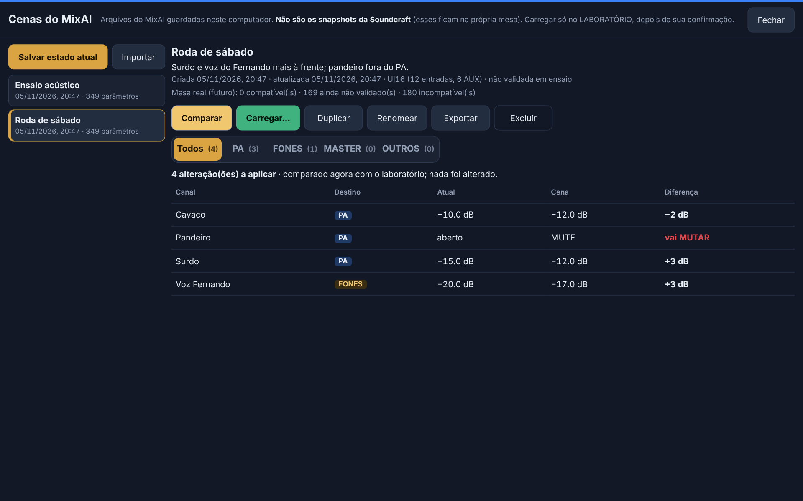

# MixAI — controle da Soundcraft Ui16 por IA

Deixa o Claude (e, a partir da E3, a tela do notebook e os celulares) ajustar a Ui16 por
comandos em português ("sobe a voz 1 no retorno do cavaco"), com travas de segurança,
desfazer, log e **aprovação humana** das operações críticas.

Desde a v0.4 (E2) existe um **servidor único** (`npm run serve:lab` / `serve:real`) que é o dono
da mesa; o MCP do Claude Desktop é só um cliente dele. Detalhes: `docs/lab/06-E2-SERVIDOR.md`.

No laboratório, o operador pode abrir **EQ LAB** para editar quatro bandas e HPF com curva
estimada, bypass, reset e desfazer. Também pode comparar presets orientativos de samba/pagode
e aplicar explicitamente no simulador. Tudo é simulado; veja [E7A](docs/lab/11-E7A-EQ.md)
e [E7B — guias de EQ](docs/lab/16-E7B-EQ-GUIDES.md).

## O que precisa

- Node.js 22 ou mais novo (`node -v`)
- Claude Desktop (para conversar com a mesa pela IA)
- A mesa só é necessária para o modo real; tudo funciona no modo simulado.

## Instalar

```bash
cd mixai
npm install
npm run build
npm test        # testes do núcleo; todos devem passar
npm ci --prefix web && npm run build:web   # interface (E3)
```

## Ensaio integrado no Yoga (F0B)

Com dependências e Chromium previamente instalados, rode `npm run smoke:yoga`.
O comando faz builds/contratos e ensaia LAB em loopback/porta efêmera, com dados e PINs
sintéticos descartáveis. Não usa a Ui16 nem altera a rede. Se faltar browser, informa
como instalar separadamente, sem download automático. [Roteiro Windows/celular, diagnóstico
somente consulta e portão para F0 físico](docs/lab/17-F0B-YOGA-REHEARSAL.md).

## Testar sem a mesa: laboratório ou simulador

São dois modos sem a mesa física, e **nenhum dos dois abre conexão de rede**:

| Modo | Para quê | Guarda o estado? |
| --- | --- | --- |
| `lab` (padrão do `config.yaml`) | treinar, preparar e testar no dia a dia | **sim**, em `data/lab-state.json` |
| `mock` | testes automatizados e experiências rápidas | não (perde tudo ao fechar) |

```bash
npm run console:lab     # laboratório (persistente)
npm run console:mock    # simulador em memória
```

**Arquivo do laboratório** (`lab.stateFile`, ou a variável `MIXAI_LAB_FILE`):
- JSON versionado (`schemaVersion`), gravado de forma **atômica** (temporário + troca);
- a versão anterior válida fica em `lab-state.json.bak`;
- se o arquivo estiver corrompido, ele é guardado como `lab-state.json.corrupt-<data>`
  e o laboratório volta do `.bak` (ou do estado padrão), com aviso no log;
- arquivo de uma versão **mais nova** do MixAI não é aberto nem alterado.

O laboratório guarda EQ de 4 bandas, HPF e bypass por canal. O operador pode editá-los
na tela **EQ LAB** (E7A) e comparar/aplicar presets orientativos (E7B), exclusivamente
no simulador. Esses parâmetros continuam `simulated_only`, sem aplicação à Ui16 real.
Os valores iniciais do laboratório são neutros do MixAI, **não** os padrões de fábrica da Ui16.

Exemplos no console:

```
estado
sobe voz 1 3
desce cavaco
sobe voz 1 3 @ retorno do cavaco
muta surdo
abre surdo
master -3
desfazer
log
```

## Servidor único (E2)

```bash
npm run pin -- operador   # cadastra o PIN do operador (grava só o hash, fora do Git)
npm run pin -- musico     # opcional: PIN dos músicos (fones; PA só se server.musicianAccess permitir)
npm run serve:lab         # laboratório em http://127.0.0.1:8790
npm run serve:real        # mesa física em http://127.0.0.1:8791
```

- Só um processo controla a mesa: um segundo servidor (ou o console) é recusado.
- Por padrão só o próprio notebook acessa (`127.0.0.1`). Para os celulares no Wi-Fi, configure
  `server.lan` com o IP do **Wi-Fi do notebook** (não o da mesa) no **`config/config.local.yaml`**
  (fora do Git; modelo em `config/config.local.example.yaml`), não no `config.yaml`. Passo a passo
  do Windows (rede Privada, firewall como administrador, reserva de IP) em `docs/lab/06-E2-SERVIDOR.md`.
- O `npm run pin` precisa de um terminal interativo (não aceita PIN por pipe ou argumento).
- **Atenção:** pela rede o acesso é HTTP/WebSocket **sem criptografia**: PIN e tokens podem ser
  capturados por quem estiver no mesmo Wi-Fi. No modo REAL pela rede, use só uma rede privada
  dedicada e confiável (roteador da banda, senha forte, sem convidados), nunca o Wi-Fi do evento.
- Operações críticas (master, snapshot, passo grande, mute em massa) viram **pendências** que só
  um operador autenticado aprova. O assistente propõe, mas não confirma.

## Interface na tela (E3)

Com o servidor rodando (`npm run serve:lab`), abra **http://127.0.0.1:8790** no Yoga e entre com o
PIN. O operador vê a **Mesa** (faders do PA ou dos FONES, MUTE, master com aprovação, Desfazer,
Histórico e os cartões de aprovação); o músico vê só os **Fones** (− / + de 2 dB no AUX 1) ou,
com `server.musicianAccess: pa_without_master`, as abas **FONES** e **PA** (canais em passos de até
3 dB, mute de um canal; nunca o master; acima de 3 dB o operador aprova — `docs/lab/09-AJUSTES-YOGA.md`).
Celulares: configure `server.lan` (no `config.local.yaml`) e abra `http://<ip-do-wi-fi-do-notebook>:8790`.
Detalhes, capturas e testes: `docs/lab/07-E3-INTERFACE.md`.

[Operação ao vivo](docs/live-ux/README.md): resumo do canal selecionado, destinos PA/AUX, sincronização, retornos das propostas e verificações técnicas guiadas, com capturas desktop/Yoga/celular e limites de integração.


## Celular (deitado e retrato)

Em **retrato**, a barra da Mesa é compacta (PA/FONES, campo + Enviar e Chat · Desfazer · Histórico ·
Cenas com ícones numa linha; `docs/lab/12-CELULAR-RETRATO-BARRA.md`). A Mesa funciona com o celular **deitado**: barra compacta numa linha, faders inteiros com rolagem
horizontal dos canais, MASTER separado à direita e a página rolando na vertical; girar a tela não
envia nenhum comando. O músico tem **MUTE / ABRIR** por canal nos FONES (e no PA, se
`server.musicianAccess` permitir). Detalhes e capturas: `docs/lab/11-CELULAR-PAISAGEM-MUTE.md`.

## AutoConfig — núcleo virtual (LAB/MOCK)

Propostas estruturadas podem ser preparadas, autorizadas individualmente pelo operador,
simuladas e revisadas pela API. Nenhum mixer é movimentado: referências candidatas são
salvas como **não aplicadas** e separadas do estado observado. Contratos B/C e limites
estão no [manual do núcleo AutoConfig](docs/autoconfig/CORE.md). Não há escrita REAL.

## Passagem de som (LAB)

Na Mesa do operador, **Passagem de som — assistente LAB** oferece checklist por evento,
aprovações humanas, histórico e retomada após interrupção, reutilizando referências e
pedidos existentes. Não executa ajustes nem carrega cenas. Veja o [procedimento e os
limites de evidência](docs/lab/SOUNDCHECK-ASSISTANT.md).

## Referência e solicitações (LAB)

O painel na Mesa/Fones permite salvar referências aprovadas do estado observado, comparar
versões sem restauração e acompanhar pedidos dos músicos. Aprovar uma orientação não executa
ajustes. Identidade usa o vínculo de sessão do servidor (incluindo múltiplos canais); a bandeja do
operador consulta a base técnica offline sem criar propostas, duplicar autenticação ou executar ajustes.
Veja [operação, persistência e dependências](docs/lab/MIX-REFERENCE-REQUESTS.md).
O [atendimento guiado](docs/lab/GUIDED-REQUESTS.md) permite consultar, revisar e enviar
o contexto ao operador, acompanhar esclarecimentos e encerrar sem executar ajustes.

## Cenas do MixAI (E5)

Na Mesa, o botão **Cenas** abre um painel para salvar o estado do LABORATÓRIO como cena (nome e
descrição), duplicar, renomear, excluir, exportar/importar JSON e **comparar** com o estado atual.
Carregar é sempre: comparar → pedir → **aprovar o cartão** (o mesmo das operações críticas); um
toque em Desfazer volta a cena inteira. Cena do MixAI (arquivo em `data/scenes/`) **não é**
snapshot da Soundcraft. Só o operador; só no laboratório. Detalhes: `docs/lab/10-E5-CENAS.md`.



## Comparação offline LAB × REAL (E8A)

O [comparador somente leitura](docs/lab/16-E8A-READONLY-DIFF.md) recebe cenas/estados e
retratos fornecidos (fixtures), classifica diferenças e exporta JSON/Markdown. Não abre
conexão, não aplica valores e não valida EQ/HPF ou saídas físicas da Ui16. F0 físico/E6
continuam pendentes. O documento inclui comandos para gerar relatório fictício sem mesa.

## Assistente de texto (E4)

Na Mesa e na tela de Fones há um campo **"O que você deseja ajustar?"**. Exemplos: "aumenta um
pouco o surdo no PA", "sobe o cavaco nos fones", "muta o pandeiro no PA", "desfaz". Tudo vira um
**cartão de proposta** (canal, destino, agora → fica) e só muda ao tocar em **Aplicar**. Sem
destino claro, ele pergunta "PA ou FONES?". Funciona sem internet.

Opcional: com uma chave da API da Anthropic no servidor (`config/secrets.yaml` →
`anthropicApiKey`, ou `ANTHROPIC_API_KEY`) e `ai.enabled: true`, pedidos vagos ("tá embolado")
vão para o Claude, com teto de gasto diário. Detalhes, modelos e custos:
`docs/lab/08-E4-ASSISTENTE.md`.

## Consulta técnica Sound Engineer (B3A)

O operador pode perguntar no chat: **"Meu cavaco está estridente. O que podemos fazer?"**.
A consulta funciona offline, usa a base especializada e pede fonte/destino quando
necessário. Mostra hipóteses, justificativas e referências, sem ouvir áudio nem criar
ajustes ou cartões de aplicação. Músicos continuam usando os comandos autorizados.
Após a pergunta PA/FONES, basta responder **"PA"** ou **"Fones"**. O contexto é
temporário, isolado por sessão e pode ser cancelado; não cria ajustes.
Detalhes: [consulta técnica](docs/sound-engineer/CHAT-READONLY.md) e
[conversa contextual](docs/sound-engineer/CONTEXT.md).
A [conversa progressiva](docs/sound-engineer/ISSUE-55-CONVERSATION.md) conduz uma pergunta/verificação por vez; detalhes permanecem estruturados, sem ajustes automáticos.
A [base técnica v2](docs/sound-engineer/ISSUE-48-KNOWLEDGE.md) amplia sintomas, perfis de samba/pagode e contratos consultivos, com fontes e limites explícitos.

## Ligar no Claude Desktop

**Antes:** deixe o servidor rodando (`npm run serve:lab`). Sem ele, o assistente responde que o
servidor não está disponível e não mexe em nada.

Edite o `claude_desktop_config.json` do Claude Desktop e acrescente o MixAI
(troque o caminho pelo da sua pasta):

```json
{
  "mcpServers": {
    "mixai": {
      "command": "node",
      "args": ["C:\\Users\\SEU_USUARIO\\mixai\\dist\\index.js"],
      "env": { "MIXAI_MODE": "lab" }
    }
  }
}
```

No Mac/Linux o caminho fica tipo `/Users/seu_usuario/mixai/dist/index.js`.
Reinicie o Claude Desktop e peça, por exemplo: *"como está a mix?"* ou
*"sobe um pouco a voz 2"*.

`"lab"` usa o laboratório persistente: o que você ajustar continua lá quando o Claude Desktop
for reaberto. Para a mesa real, troque por `"real"` (e, se precisar, acrescente
`"MIXAI_IP": "10.10.1.1"`).

## Primeiro teste na mesa real (F0 somente leitura)

A mesa ainda não chegou. A preparação offline e o roteiro Windows/Yoga estão em
[13-F0-PREFLIGHT-READONLY.md](docs/lab/13-F0-PREFLIGHT-READONLY.md), com
[formulário de evidências](docs/lab/14-F0-EVIDENCIAS-MODELO.md).

Sem hardware: `node dist/console.js --mock --readonly`. Só quando a Ui16 chegar,
com PA/fones desconectados e IP Ethernet confirmado, usar `npm run console:f0`.
Esse script fixa REAL **somente leitura**, bloqueando ajustes e snapshots mesmo em
READY e após reconexão. Usar apenas `status`, `estado`, `estado @ fones`, `nomes`,
`snapshots`, `ajuda` e `sair`. O console REAL comum e `serve:real` não são o modo F0.

Não executar os passos antigos de mover fader/desfazer. Simulações não concluem F0
físico nem autorizam E6 ou escrita real.

## Observador F0C (somente leitura)

`npm run observe:f0 -- --help` mostra os gates de execução física **manual e supervisionada**.
O [roteiro F0C](docs/lab/18-F0C-READONLY-OBSERVER.md) permite observar fader/MUTE alterados
pelo operador na UI oficial, link/reconexão e exportar evidências sanitizadas opt-in.
Aceita [Ethernet ou Wi-Fi explícitos](docs/lab/19-F0D-DUAL-TRANSPORT-READONLY.md), com IP/interface confirmados e PA/HA800/fones desconectados.
O [preflight F0E](docs/lab/20-F0E-NATIVE-ROUTE-PREFLIGHT.md) funciona sem executar arquivos `.ps1` nem alterar a política PowerShell.
O observador não roda pelo smoke/CI, não envia ajustes e não habilita E6. Sem hardware, usar apenas os testes com socket falso.

## Nomes da banda

Edite `config/channels.yaml`. Acento, maiúscula e espaço não importam.
O canal também pode ser chamado pelo número ("canal 9", "aux 3").
Confira o mapeamento com a ligação real na mesa (por exemplo, quais entradas são Hi-Z).

## Travas de segurança (`config/config.yaml`)

| Trava | Padrão |
| --- | --- |
| Teto de volume por canal / retorno / master | 0 dB |
| Mudança máxima sem confirmação | 6 dB por comando |
| Master | sempre pede confirmação |
| Mutar mais de 2 canais de uma vez | pede confirmação |
| Carregar snapshot | sempre pede confirmação |
| Comandos por segundo | 5 |
| Ganho de entrada e phantom | a IA não tem acesso |

Pedir confirmação nunca altera nada: vira uma pendência que **só o operador aprova**, com PIN,
pelo canal de aprovação do servidor (a tela chega na E3). Veja a seção abaixo.

## Reconexão e confirmações (desde a v0.2 / E0)

**Reconexão segura (mesa real).**
- A biblioteca da mesa guardava comandos dados com a conexão caída e os reenviava ao reconectar.
- Agora, na primeira queda, o MixAI **descarta** a conexão inteira, cria outra do zero e
  **ressincroniza** o estado da mesa antes de aceitar qualquer comando. **Nada é reenviado.**
- Estados (aparecem em `status`/`mixer_status`):
  - `READY`: lê e escreve;
  - `DEGRADED_READ_ONLY`: a mesa ainda não mandou tudo; lê o que chegou, não escreve;
  - `SYNCING`/`CONNECTING`: nenhum comando;
  - `LOST`: caiu, tentando de novo;
  - `STOPPED`: controle interrompido; use a interface oficial da Soundcraft.
- A Ui16 **não confirma** comandos. Na mesa real, o MixAI diz "enviado", nunca "aplicado".
- Comandos enviados até 3 s antes de uma queda são conferidos depois da reconexão e aparecem
  em `mixer_status`, sem serem repetidos:
  - "a mesa mostra o valor desejado" (isso não prova que foi o MixAI);
  - "a mesa mostra outro valor";
  - "indeterminado".

**Confirmações (desde a E2).**
- Ações críticas devolvem `NEEDS_CONFIRMATION`: nada foi alterado e a pendência vai para os
  operadores (`/api/pending`, WebSocket `pending`).
- Só um **operador autenticado** aprova (`approve`) ou recusa (`reject`). O assistente não
  consegue: `confirmation_id` enviado por ele é recusado com `FORBIDDEN`, e o canal de aprovação
  não aceita o token dele.
- A pendência vale **uma vez**, por **60 s**, e é invalidada se algum parâmetro envolvido mudar
  antes (`CONFIRMATION_STALE`) ou se o laboratório for resetado.

**Desfazer.**
- O desfazer compara a **revisão** de cada parâmetro: se outra pessoa (ou a mesa, ou uma
  reconexão) mexeu depois, ele recusa aquele item para não apagar a mudança dela.
- Comandos com resultado **incerto** (enviados perto de uma queda, ou interrompidos por erro)
  **não podem ser desfeitos** pelo MixAI, mesmo que a mesa mostre o valor esperado.
- Alterações seguidas do próprio MixAI no mesmo fader podem ser desfeitas em sequência.
- Operações em vários canais que caem no meio são marcadas como **PARCIAL**, e o desfazer
  cobre só o que foi enviado.

**Nomes.** Só canais e AUX do `channels.yaml` podem ser alterados (`naming.allowUnmapped: false`).
"aux 4" ou "canal 12", sem cadastro, são recusados.

## Log

Cada ação (e cada recusa) vai para `logs/acoes-AAAA-MM-DD.jsonl`.

## Estrutura

```
src/
  serve.ts            servidor único (E2): HTTP + WebSocket, dono da mesa; serve a interface
web/                  interface Angular (E3): Mesa, Fones, PIN, cartões
  server/             núcleo do servidor, rotas, perfis, PIN, medidores simulados
  client/             cliente de referência da sincronização de estado
  index.ts            MCP (stdio) — cliente HTTP do servidor
  pin.ts              cadastro de PIN (só hash)
  console.ts          console de teste sem IA (respeita a trava de dono)
  mcp/server.ts       tools e instruções para a IA
  mcp/remote.ts       cliente HTTP usado pelas tools
  core/controller.ts  travas, fila, desfazer, confirmações, log
  core/params.ts      registro central de parâmetros (unidade, faixa, capacidade)
  core/state.ts       estado observável: snapshot, eventos, revisões
  core/scene.ts       estrutura de cenas e diff (sem tela ainda)
  core/channels.ts    nomes da banda -> números
  core/config.ts      leitura do config.yaml e channels.yaml
  mixer/real.ts       mesa real (soundcraft-ui-connection) + supervisor de conexão
  mixer/lab.ts        laboratório persistente (lab-store.ts: arquivo, backup, recuperação)
  mixer/mock.ts       simulador em memória (testes)
  mixer/simulated.ts  base comum dos simuladores (sem rede)
config/               config.yaml e channels.yaml
test/                 testes (Vitest)
```

## Problemas comuns

- **"Não consegui conectar"**: confira o IP da mesa e se o notebook está na mesma rede.
- **Claude Desktop não mostra as tools**: confira o caminho absoluto do `dist/index.js`
  e se rodou `npm run build`.
- **"INDETERMINATE"**: a resposta se perdeu (queda ou reinício do servidor) e a alteração **pode** ter
  sido aplicada. Não repita: confira o estado da mix primeiro.
- **"SERVER_UNAVAILABLE"**: o servidor não está rodando. Abra um terminal e rode
  `npm run serve:lab` (ou `serve:real`).
- **"Outro processo do MixAI ... já controla isto"**: já existe um servidor (ou console) aberto.
  Use o que está rodando, ou feche-o.
- **Celular não abre a página**: confira `server.lan.host` no `config/config.local.yaml` (IP do
  Wi-Fi do notebook), se o celular está no mesmo Wi-Fi, se a rede está como **Privada** e se existe
  a regra "MixAI LAB" no firewall (PowerShell como administrador; ver `docs/lab/06-E2-SERVIDOR.md`).
- **Mandei um pedido no assistente e "nada aconteceu"**: a resposta sempre aparece na conversa
  (desde a correção da `09-AJUSTES-YOGA.md`). Se o botão Enviar estiver desabilitado, o motivo está
  escrito logo abaixo dele.
- **"CONTROL_STOPPED" ou "DEGRADED_READ_ONLY" durante um evento**: não insista pelo MixAI;
  use a interface oficial da Soundcraft. O som continua com o último ajuste.
- **Voltar para a versão anterior** (fora de evento): `git checkout baseline-v0.1.0 && npm ci && npm run build`
  e reinicie o Claude Desktop.
- **Depois de atualizar o firmware da mesa algo parou**: a biblioteca usa o protocolo
  da interface web, que não é oficial. Teste no console antes de qualquer evento.
  A versão da biblioteca está fixada em `package.json` de propósito.

Experimento de voz E9A (desativado por padrão, somente LAB, sem execução de comandos):
[arquitetura, HTTPS/WSS e avaliação de provedores](docs/E9A-SPEECH-SPIKE.md).

HTTPS/WSS privado opcional para LAB (Yoga + Android, voz continua OFF):
[instalação manual e validação E9B](docs/lab/16-E9B-HTTPS-LAN.md).

Bancada offline de STT E9C (whisper.cpp configurado manualmente, sem execução de comandos):
[guia Windows, WAV autorizado, demo simulada e métricas](docs/lab/17-E9C-OFFLINE-STT.md).

Push-to-talk privado E9D (opt-in server-side, operador em HTTPS LAB, prévia sem comandos):
[configuração e validação Yoga/Android](docs/lab/18-E9D-PRIVATE-PTT-LAB.md).

No LAB, o operador pode vincular uma sessão de músico aos canais autorizados, sem mudar os
dois PINs existentes. Veja [músicos e canais vinculados](docs/musicians/session-channel-access.md).
AUX1 continua sendo o retorno compartilhado de todos no HA800.

Biblioteca técnica e Instrutor somente leitura: [Issue #65](docs/sound-engineer/ISSUE-65-LIBRARY.md), com contratos, importação reversível e avaliação lexical reproduzível.

Planejador AutoConfig LAB: [contratos e ensaio offline da Issue #73](docs/autoconfig/ISSUE-73-PLANNER.md). Integração consultiva com M1 e núcleo D: [contratos e limites](docs/autoconfig/INTEGRATION-78.md). A interface B já utiliza D, mas ainda não consome as perguntas e inspeções do planejador C; a integração ponta a ponta permanece pendente. Sem execução na mesa ou números inventados.
