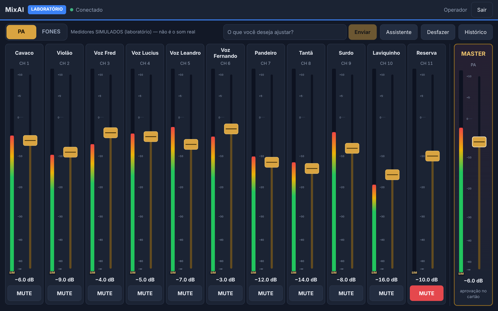

# MixAI — controle da Soundcraft Ui16 por IA

Deixa o Claude (e, a partir da E3, a tela do notebook e os celulares) ajustar a Ui16 por
comandos em português ("sobe a voz 1 no retorno do cavaco"), com travas de segurança,
desfazer, log e **aprovação humana** das operações críticas.

Desde a v0.4 (E2) existe um **servidor único** (`npm run serve:lab` / `serve:real`) que é o dono
da mesa; o MCP do Claude Desktop é só um cliente dele. Detalhes: `docs/lab/06-E2-SERVIDOR.md`.

## O que precisa

- Node.js 22 ou mais novo (`node -v`)
- Claude Desktop (para conversar com a mesa pela IA)
- A mesa só é necessária para o modo real; tudo funciona no modo simulado.

## Instalar

```bash
cd mixai
npm install
npm run build
npm test        # 276 testes, todos devem passar
npm ci --prefix web && npm run build:web   # interface (E3)
```

## Testar sem a mesa: laboratório ou simulador

São dois modos sem a mesa física, e **nenhum dos dois abre conexão de rede**:

| Modo | Para quê | Guarda o estado? |
| --- | --- | --- |
| `lab` (padrão do `config.yaml`) | treinar, preparar e testar no dia a dia | **sim**, em `data/lab-state.json` |
| `mock` | testes automatizados e experiências rápidas | não (perde tudo ao fechar) |

```bash
npm run console:lab     # laboratório (persistente)
npm run console:mock    # simulador em memória
```

**Arquivo do laboratório** (`lab.stateFile`, ou a variável `MIXAI_LAB_FILE`):
- JSON versionado (`schemaVersion`), gravado de forma **atômica** (temporário + troca);
- a versão anterior válida fica em `lab-state.json.bak`;
- se o arquivo estiver corrompido, ele é guardado como `lab-state.json.corrupt-<data>`
  e o laboratório volta do `.bak` (ou do estado padrão), com aviso no log;
- arquivo de uma versão **mais nova** do MixAI não é aberto nem alterado.

O laboratório já guarda EQ de 4 bandas, HPF e bypass por canal, mas eles **ainda não têm
tool nem tela**: entram nas próximas etapas (E7). Os valores iniciais do laboratório são
neutros do MixAI, **não** os padrões de fábrica da Ui16.

Exemplos no console:

```
estado
sobe voz 1 3
desce cavaco
sobe voz 1 3 @ retorno do cavaco
muta surdo
abre surdo
master -3
desfazer
log
```

## Servidor único (E2)

```bash
npm run pin -- operador   # cadastra o PIN do operador (grava só o hash, fora do Git)
npm run pin -- musico     # opcional: PIN dos músicos (só ajustam o AUX 1, os fones)
npm run serve:lab         # laboratório em http://127.0.0.1:8790
npm run serve:real        # mesa física em http://127.0.0.1:8791
```

- Só um processo controla a mesa: um segundo servidor (ou o console) é recusado.
- Por padrão só o próprio notebook acessa (`127.0.0.1`). Para os celulares no Wi-Fi, configure
  `server.lan` com o IP do **Wi-Fi do notebook** (não o da mesa) — passo a passo em `docs/lab/06-E2-SERVIDOR.md`.
- **Atenção:** pela rede o acesso é HTTP/WebSocket **sem criptografia**: PIN e tokens podem ser
  capturados por quem estiver no mesmo Wi-Fi. No modo REAL pela rede, use só uma rede privada
  dedicada e confiável (roteador da banda, senha forte, sem convidados), nunca o Wi-Fi do evento.
- Operações críticas (master, snapshot, passo grande, mute em massa) viram **pendências** que só
  um operador autenticado aprova. O assistente propõe, mas não confirma.

## Interface na tela (E3)

Com o servidor rodando (`npm run serve:lab`), abra **http://127.0.0.1:8790** no Yoga e entre com o
PIN. O operador vê a **Mesa** (faders do PA ou dos FONES, MUTE, master com aprovação, Desfazer,
Histórico e os cartões de aprovação); o músico vê só os **Fones** (− / + de 2 dB no AUX 1).
Celulares: configure `server.lan` e abra `http://<ip-do-wi-fi-do-notebook>:8790`.
Detalhes, capturas e testes: `docs/lab/07-E3-INTERFACE.md`.



## Assistente de texto (E4)

Na Mesa e na tela de Fones há um campo **"O que você deseja ajustar?"**. Exemplos: "aumenta um
pouco o surdo no PA", "sobe o cavaco nos fones", "muta o pandeiro no PA", "desfaz". Tudo vira um
**cartão de proposta** (canal, destino, agora → fica) e só muda ao tocar em **Aplicar**. Sem
destino claro, ele pergunta "PA ou FONES?". Funciona sem internet.

Opcional: com uma chave da API da Anthropic no servidor (`config/secrets.yaml` →
`anthropicApiKey`, ou `ANTHROPIC_API_KEY`) e `ai.enabled: true`, pedidos vagos ("tá embolado")
vão para o Claude, com teto de gasto diário. Detalhes, modelos e custos:
`docs/lab/08-E4-ASSISTENTE.md`.

## Ligar no Claude Desktop

**Antes:** deixe o servidor rodando (`npm run serve:lab`). Sem ele, o assistente responde que o
servidor não está disponível e não mexe em nada.

Edite o `claude_desktop_config.json` do Claude Desktop e acrescente o MixAI
(troque o caminho pelo da sua pasta):

```json
{
  "mcpServers": {
    "mixai": {
      "command": "node",
      "args": ["C:\\Users\\SEU_USUARIO\\mixai\\dist\\index.js"],
      "env": { "MIXAI_MODE": "lab" }
    }
  }
}
```

No Mac/Linux o caminho fica tipo `/Users/seu_usuario/mixai/dist/index.js`.
Reinicie o Claude Desktop e peça, por exemplo: *"como está a mix?"* ou
*"sobe um pouco a voz 2"*.

`"lab"` usa o laboratório persistente: o que você ajustar continua lá quando o Claude Desktop
for reaberto. Para a mesa real, troque por `"real"` (e, se precisar, acrescente
`"MIXAI_IP": "10.10.1.1"`).

## Primeiro teste na mesa real (Fase 0)

Faça num ensaio ou com o PA desligado, nunca no meio de um evento.

1. Ligue o notebook na mesa (cabo de rede ou Wi-Fi da mesa).
2. Abra a interface da mesa no navegador e confirme o IP.
3. Rode `npm run console` (ou `node dist/console.js --real`).
4. `status` → deve mostrar "Conectado à mesa em ...".
5. `estado` → os volumes devem bater com a tela da mesa.
6. `desce voz 1` → o fader da Voz 1 tem que descer 2 dB na tela da mesa.
7. `desfazer` → volta ao que era.

Se os passos 4 a 7 funcionarem, a Fase 0 está fechada.

## Nomes da banda

Edite `config/channels.yaml`. Acento, maiúscula e espaço não importam.
O canal também pode ser chamado pelo número ("canal 9", "aux 3").
Confira o mapeamento com a ligação real na mesa (por exemplo, quais entradas são Hi-Z).

## Travas de segurança (`config/config.yaml`)

| Trava | Padrão |
| --- | --- |
| Teto de volume por canal / retorno / master | 0 dB |
| Mudança máxima sem confirmação | 6 dB por comando |
| Master | sempre pede confirmação |
| Mutar mais de 2 canais de uma vez | pede confirmação |
| Carregar snapshot | sempre pede confirmação |
| Comandos por segundo | 5 |
| Ganho de entrada e phantom | a IA não tem acesso |

Pedir confirmação nunca altera nada: vira uma pendência que **só o operador aprova**, com PIN,
pelo canal de aprovação do servidor (a tela chega na E3). Veja a seção abaixo.

## Reconexão e confirmações (desde a v0.2 / E0)

**Reconexão segura (mesa real).**
- A biblioteca da mesa guardava comandos dados com a conexão caída e os reenviava ao reconectar.
- Agora, na primeira queda, o MixAI **descarta** a conexão inteira, cria outra do zero e
  **ressincroniza** o estado da mesa antes de aceitar qualquer comando. **Nada é reenviado.**
- Estados (aparecem em `status`/`mixer_status`):
  - `READY`: lê e escreve;
  - `DEGRADED_READ_ONLY`: a mesa ainda não mandou tudo; lê o que chegou, não escreve;
  - `SYNCING`/`CONNECTING`: nenhum comando;
  - `LOST`: caiu, tentando de novo;
  - `STOPPED`: controle interrompido; use a interface oficial da Soundcraft.
- A Ui16 **não confirma** comandos. Na mesa real, o MixAI diz "enviado", nunca "aplicado".
- Comandos enviados até 3 s antes de uma queda são conferidos depois da reconexão e aparecem
  em `mixer_status`, sem serem repetidos:
  - "a mesa mostra o valor desejado" (isso não prova que foi o MixAI);
  - "a mesa mostra outro valor";
  - "indeterminado".

**Confirmações (desde a E2).**
- Ações críticas devolvem `NEEDS_CONFIRMATION`: nada foi alterado e a pendência vai para os
  operadores (`/api/pending`, WebSocket `pending`).
- Só um **operador autenticado** aprova (`approve`) ou recusa (`reject`). O assistente não
  consegue: `confirmation_id` enviado por ele é recusado com `FORBIDDEN`, e o canal de aprovação
  não aceita o token dele.
- A pendência vale **uma vez**, por **60 s**, e é invalidada se algum parâmetro envolvido mudar
  antes (`CONFIRMATION_STALE`) ou se o laboratório for resetado.

**Desfazer.**
- O desfazer compara a **revisão** de cada parâmetro: se outra pessoa (ou a mesa, ou uma
  reconexão) mexeu depois, ele recusa aquele item para não apagar a mudança dela.
- Comandos com resultado **incerto** (enviados perto de uma queda, ou interrompidos por erro)
  **não podem ser desfeitos** pelo MixAI, mesmo que a mesa mostre o valor esperado.
- Alterações seguidas do próprio MixAI no mesmo fader podem ser desfeitas em sequência.
- Operações em vários canais que caem no meio são marcadas como **PARCIAL**, e o desfazer
  cobre só o que foi enviado.

**Nomes.** Só canais e AUX do `channels.yaml` podem ser alterados (`naming.allowUnmapped: false`).
"aux 4" ou "canal 12", sem cadastro, são recusados.

## Log

Cada ação (e cada recusa) vai para `logs/acoes-AAAA-MM-DD.jsonl`.

## Estrutura

```
src/
  serve.ts            servidor único (E2): HTTP + WebSocket, dono da mesa; serve a interface
web/                  interface Angular (E3): Mesa, Fones, PIN, cartões
  server/             núcleo do servidor, rotas, perfis, PIN, medidores simulados
  client/             cliente de referência da sincronização de estado
  index.ts            MCP (stdio) — cliente HTTP do servidor
  pin.ts              cadastro de PIN (só hash)
  console.ts          console de teste sem IA (respeita a trava de dono)
  mcp/server.ts       tools e instruções para a IA
  mcp/remote.ts       cliente HTTP usado pelas tools
  core/controller.ts  travas, fila, desfazer, confirmações, log
  core/params.ts      registro central de parâmetros (unidade, faixa, capacidade)
  core/state.ts       estado observável: snapshot, eventos, revisões
  core/scene.ts       estrutura de cenas e diff (sem tela ainda)
  core/channels.ts    nomes da banda -> números
  core/config.ts      leitura do config.yaml e channels.yaml
  mixer/real.ts       mesa real (soundcraft-ui-connection) + supervisor de conexão
  mixer/lab.ts        laboratório persistente (lab-store.ts: arquivo, backup, recuperação)
  mixer/mock.ts       simulador em memória (testes)
  mixer/simulated.ts  base comum dos simuladores (sem rede)
config/               config.yaml e channels.yaml
test/                 testes (Vitest)
```

## Problemas comuns

- **"Não consegui conectar"**: confira o IP da mesa e se o notebook está na mesma rede.
- **Claude Desktop não mostra as tools**: confira o caminho absoluto do `dist/index.js`
  e se rodou `npm run build`.
- **"INDETERMINATE"**: a resposta se perdeu (queda ou reinício do servidor) e a alteração **pode** ter
  sido aplicada. Não repita: confira o estado da mix primeiro.
- **"SERVER_UNAVAILABLE"**: o servidor não está rodando. Abra um terminal e rode
  `npm run serve:lab` (ou `serve:real`).
- **"Outro processo do MixAI ... já controla isto"**: já existe um servidor (ou console) aberto.
  Use o que está rodando, ou feche-o.
- **Celular não abre a página**: confira `server.lan.host` (IP do Wi-Fi do notebook), se o
  celular está no mesmo Wi-Fi e se o firewall do Windows permitiu em "Redes privadas".
- **"CONTROL_STOPPED" ou "DEGRADED_READ_ONLY" durante um evento**: não insista pelo MixAI;
  use a interface oficial da Soundcraft. O som continua com o último ajuste.
- **Voltar para a versão anterior** (fora de evento): `git checkout baseline-v0.1.0 && npm ci && npm run build`
  e reinicie o Claude Desktop.
- **Depois de atualizar o firmware da mesa algo parou**: a biblioteca usa o protocolo
  da interface web, que não é oficial. Teste no console antes de qualquer evento.
  A versão da biblioteca está fixada em `package.json` de propósito.
