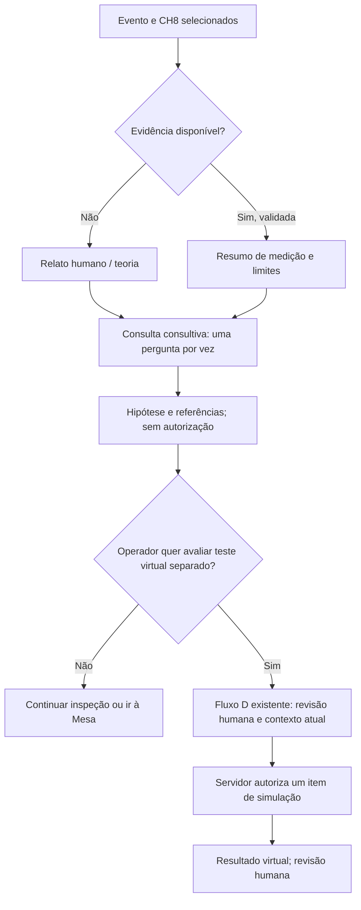

# Experiência de análise de áudio e AutoConfig — proposta de UX

**Status: projeto para revisão; não implementado na aplicação.** Relacionado à [Issue #81](https://github.com/dodoxbr/MixAI/issues/81). Auditoria feita em `origin/main` **5e2c0c3**, com PRs #77, #78 e #80 incorporados. Integração AutoConfig em andamento pelo Claude não é alterada por esta entrega.

Entregáveis: este documento (auditoria, fluxos, estados, critérios e integração futura) e [WIREFRAMES.html](WIREFRAMES.html), estático, escuro e responsivo. O HTML não contém áudio, espectro, dados de exemplo numéricos, JavaScript, API ou IA. Os controles de ação estão desabilitados; somente navegação documental e detalhes expansíveis funcionam.

## 1. Resultado pretendido e limites

Durante a passagem, o operador seleciona **CH8 — Surdo**, identifica **o que está sendo captado**, vê espectro somente quando a fonte fornecer dados verificáveis e pode pedir orientação consultiva. Ver um espectro não prova bom timbre, inteligibilidade, SPL ou uma causa de problema. Diagnóstico não cria proposta de alteração.

Duas dimensões ficam separadas: **modo operacional** (AutoConfig continua SIMULAÇÃO LAB) e **origem da evidência** (captura real, simulação, relato, hipótese, indisponível). Uma futura captura real de sinal usada em laboratório não autoriza modo REAL/escrita. Esta proposta não habilita captura nem consumo de novas evidências em produção.

Não existe botão para ativar, trocar ou tomar o RTA da Ui16, nem para aplicar EQ/ganho/phantom/AFS/cena. A Issue #81 registra RTA de entrada em um canal por vez, com disputa entre clientes; selecionar CH8 no MixAI **não** seleciona remotamente o RTA. A interface oficial continua sendo a ferramenta de operação da mesa. Gravação USB estéreo não comprova captura individual, multitrack ou interface USB de áudio para PC.

## 2. Auditoria da base atual

| Área inspecionada | Evidência atual | Consequência de UX |
| --- | --- | --- |
| [Mesa e passagem](../../web/src/app/views/mesa.component.ts) | Abas Mesa/Passagem; faders ficam fora da passagem; entrada da passagem somente LAB | Reusar navegação e evento; Mesa em um toque, sem modal cobrindo faders/chat |
| [Painel AutoConfig](../../web/src/app/autoconfig/autoconfig.component.ts) | SIMULAÇÃO LAB, quatro perguntas progressivas, passo virtual humano, detalhes, estado do servidor e referências persistidas | Preservar autorização e rótulos. Separar consulta técnica da entrada de número; não exigir formulário de ajuste para olhar áudio |
| [Serviço da UI](../../web/src/app/autoconfig/autoconfig.service.ts) e [HTTP](../../web/src/app/autoconfig/autoconfig-http.ts) | Consome workspace/plano/actions; estado vem do servidor; guardas de sessão, revisão, erro e reconexão | Evidência nova não altera aprovação, digest ou recibos; não transformar atualização de gráfico em mutação |
| [Núcleo D](../../src/autoconfig/contracts.ts), [documentação](../autoconfig/CORE.md) | Apenas `level_delta` virtual; medição acústica/REAL indisponível; aprovação por item no servidor | Seu antes/depois numérico não é espectro nem resultado acústico; nunca desenhar curva a partir de fader/delta |
| [Medidores atuais](../../src/server/meters.ts) | `simulated:true`, níveis derivados de fader/mute e variação; sem bins de frequência | Não usar estes níveis como FFT, VU físico ou energia medida do surdo |
| [Integração consultiva #78](../autoconfig/INTEGRATION-78.md), [fonte de sugestões](../../src/autoconfig/suggestion-source.ts) | Rota consultiva LAB existente; documentação registra lacuna C → B → D na UI auditada | Reaproveitar o trabalho do Claude; não criar segunda conversa ou assumir integração já concluída |
| [Planejador C](../../src/autoconfig/planner/contracts.ts) | Contrato atual fixa `measurements: unavailable` e evidência relatada, não medida | Uma futura medição exige revisão própria do contrato; não injetar bins em campos de relato ou prometer suporte atual |
| [Mapa da banda](../../config/channels.yaml) | CH8 Surdo, CH3 voz principal Fred, CH1 Cavaco; AUX1 compartilhado HA800 | Cadastro seleciona interesse, não comprova vínculo da captura ao canal |
| Descoberta #81 | Existência de RTA visual confirmada na issue; acesso a bins, resolução e ponto de leitura desconhecidos | Estado inicial honesto: **Sem captura de áudio**; não anunciar RTA nativo conectado |

Riscos de experiência atuais: avisos e identificadores ocupam altura antes da tarefa; criação de rascunho pede número cedo demais para uma consulta; estados canônicos em inglês exigem interpretação; reconexão pode remontar a passagem. A proposta mantém os guardas, resume o essencial e move auditoria/IDs para detalhes, sem esconder a origem nem pedir novamente fatos válidos já conhecidos.

## 3. Hierarquia da tela

Ordem de leitura e foco, igual no Yoga e celular:

1. Navegação existente **Mesa / Passagem** e título curto do evento.
2. **CH8 — Surdo**, caminho de interesse (PA ou FONES/AUX1 compartilhado), modo e conexão MixAI.
3. Fonte realmente observada + vínculo ao canal + estado da captura + idade do quadro. Esses dados ficam junto ao gráfico, inclusive em tela ampliada.
4. Espectro ou mensagem vazia explícita; resumo textual equivalente.
5. Até três destaques de frequência quando sustentados pelos dados; ação **Consultar IA**.
6. Consulta curta, uma pergunta por vez; **Justificativa e referências** expansíveis.
7. **Comparar A/B** e, separadamente, acesso ao fluxo virtual existente do AutoConfig. Auditoria extensa em detalhes.

No estado inicial bastam contexto, ausência de captura e consulta por relato. Configuração avançada fica fora do fluxo principal; nenhuma lista de parâmetros de FFT ou formulário longo para o músico tocar uma nota. Rótulos de origem não ficam escondidos em detalhes.

### Identidade visual da evidência

| Categoria | Rótulo obrigatório | Marca visual proposta | O que significa |
| --- | --- | --- | --- |
| Captura verificada | **MEDIÇÃO DE SINAL · REAL** ou **MEDIÇÃO ACÚSTICA · REAL** | Ícone de aquisição + borda ciano + texto | Só com aquisição e vínculo comprovados; especificar sinal elétrico/linha ou captação no ambiente |
| Simulação | **SIMULAÇÃO LAB · NÃO MEDIDO** | Losango + borda âmbar, traço pontilhado se houver gráfico de fonte mock | Dado sintético de teste, nunca fallback silencioso para ausência de sinal |
| Relato | **RELATO HUMANO · NÃO MEDIDO** | Aspas + borda azul | “Surdo sem grave” é percepção declarada, não pico detectado |
| Hipótese | **HIPÓTESE DA IA · NÃO VALIDADA** | Interrogação + borda violeta | Explicação possível com evidências, limites e próximo passo consultivo |
| Ausência | **INFORMAÇÃO INDISPONÍVEL** | Travessão + borda neutra | Sem dados, sem zero presumido e sem curva |

Cor nunca é o único identificador. Texto/ícone acompanham cada cartão, legenda, captura A/B e exportação futura. Origem verificada não significa diagnóstico correto; confiança da aquisição e sustentação da hipótese são avaliações distintas. Não inventar percentuais de confiança ou “qualidade da mix”.

## 4. Fluxos do operador

### A. CH8 sem captura (estado disponível hoje)

1. Abrir Passagem → selecionar CH8 — Surdo, reaproveitando evento e seleção válida.
2. Mostrar “**Sem captura de áudio. O MixAI não ouviu o surdo.**” e “Fonte: nenhuma vinculada”. Não renderizar gráfico, pico, medidor ou linha plana.
3. Operador toca **Consultar IA**. Sem medição, o botão informa **Consultar por relato**. Se não houver relato: “O que você percebe no surdo?” e respostas curtas “Sem corpo”, “Embolado”, “Outro relato”. Não pré-selecionar sintoma.
4. Perguntar destino somente se ausente; se PA já conhecido, não perguntar de novo. Caminho de interesse não vira origem de captura.
5. Mostrar hipótese baseada em relato/teoria com referência e limites. Não dizer “detectei falta em X Hz”. Permitir “Isso não descreve o problema” ou cancelar consulta.
6. Mesa continua a um toque. Não oferecer um número, EQ ou rascunho D só porque há um relato.

### B. Fonte disponível, origem validada (futuro, condicionado à #81)

1. Mostrar identificação da fonte disponível e consentida; selecionar CH8 apenas **associa a visualização**, nunca ativa RTA remoto ou microfone.
2. Verificar vínculo. Uma captura do AUX1 representa a **mix compartilhada**, mesmo com CH8 selecionado como interesse. Sem isolamento comprovado, não chamar esse espectro de “CH8”.
3. Quando chegar quadro válido e fresco, exibir origem, rota, ponto pré/pós-EQ comprovado ou **desconhecido**, unidade e idade junto ao espectro. “Ao vivo” só após validar frescor.
4. Operador pode pausar a **visualização**; aquisição não é interrompida/ativada por esse botão. Usar rótulo “Visualização congelada”, manter idade crescendo e não usar o quadro congelado como ao vivo.
5. **Consultar IA** apresenta resumo das evidências elegíveis e do que continuará desconhecido. A IA recebe apenas evidência tipada prevista em integração futura, nunca imagem do gráfico como prova automática nem áudio bruto por padrão.
6. Se a fonte, sessão, canal, rota, evento ou conjunto de evidências mudar durante a consulta, não anexar resposta atrasada ao novo contexto. Marcar consulta anterior como histórica e exigir nova consulta explícita.

### C. Antes/depois sem promessa de causalidade

1. Com origem válida, **Marcar A — antes** congela uma janela identificada; não salva áudio por padrão. A operação não comanda a mesa.
2. Operador faz a verificação que considerar adequada fora deste painel. Anotar “alteração declarada pelo operador” não comprova que a Ui16 mudou.
3. **Marcar B — depois** congela outra janela da mesma origem e rota, após verificar comparabilidade.
4. Apresentar “Comparação observacional A/B”; nunca “ajuste funcionou” ou pontuação automática. Outra execução do surdo pode alterar o espectro por si só.
5. Se houve apenas `level_delta` virtual em D, mostrar **Resultado virtual** separado. Não há B medido decorrente desse teste e não se transforma um delta em curva espectral.

### D. Consulta → eventual AutoConfig



As setas são de navegação/decisão humana, não execução automática. Orientação sobre graves/EQ não se converte em `level_delta`. Não duplicar o trabalho C → UI → D em andamento pelo Claude; adaptar esta proposta depois de estabilizada a integração.

## 5. Wireframes de informação

O [HTML estático](WIREFRAMES.html) mostra os mesmos blocos com alvos grandes e detalhes nativos. As caixas de espectro são reservadas, **sem pontos fictícios**.

### Celular — uma coluna (360–430 px)

```text
┌────────────────────────────────────┐
│ Evento · Passagem        Conectado  │
│ CH8 — SURDO  [trocar]   PA          │
│ SIMULAÇÃO LAB (modo AutoConfig)     │
├────────────────────────────────────┤
│ INFORMAÇÃO INDISPONÍVEL             │
│ Fonte: nenhuma vinculada           │
│ Sem captura. Não ouvimos o surdo.   │
│ [espaço vazio, sem curva ou zero]   │
├────────────────────────────────────┤
│ [ Consultar IA por relato ]        │
│ Relato humano: [se informado]      │
│ HIPÓTESE IA · não validada          │
│ Uma orientação curta / pergunta.   │
│ > Justificativa e referências      │
│ > Origem, validade e comparação    │
├────────────────────────────────────┤
│ [ Mesa ]         [ Passagem ]      │
└────────────────────────────────────┘
```

Com dados válidos, substituir o vazio por área de espectro de ~180–220 px de altura, resumo e até três destaques, mantendo origem/idade visíveis. Comparação A e B em cartões empilhados, sem exigir rotação/pinça; não reduzir dois gráficos a miniaturas ilegíveis. Nenhum teclado abre para simplesmente selecionar CH8.

### Yoga — visão ampliada (referência 1536×960)

```text
┌─────────────────────────────────────────────────────────────────┐
│ [Mesa] [Passagem]  Evento · CH8 — Surdo · PA · SIMULAÇÃO LAB       │
├────────────────────────────────────┬────────────────────────────┤
│ Origem verificada / ou indisponível│ Consultar IA               │
│ Rota real · ponto · idade         │ Relato humano (se houver)  │
│                                  │ Uma pergunta por vez        │
│       ÁREA DO ESPECTRO            │ Hipótese não validada       │
│    (sem desenho neste projeto)   │ Evidências usadas/ausentes  │
│                                  │ > Justificativa/referências │
│ [Graves] [Médios] [Agudos]        │                            │
│ > Metadados da aquisição          │ [Fluxo virtual separado]   │
├────────────────────────────────────┴────────────────────────────┤
│ Comparação A/B: origem, janela, validade, resumo textual           │
└─────────────────────────────────────────────────────────────────┘
```

A partir de aproximadamente 1100 px, gráfico e consulta lado a lado; abaixo, uma coluna. Em celular paisagem baixo (~780×360), não forçar duas colunas ou fullscreen: cabeçalho compacto, rolagem normal e Mesa sempre alcançável. “Ampliar” futuro afeta somente a área visual e mantém saída por teclado, contexto e origem; não muda aquisição/RTA.

## 6. Espectro, frequências e carga cognitiva

- **Eixo X:** frequência em escala logarítmica, limitada à faixa realmente entregue pela fonte e a Nyquist quando aplicável. Referência visual usual 20 Hz–20 kHz não é promessa de cobertura. Lacunas ficam ausentes, sem interpolação que finja medição.
- **Eixo Y:** unidade comprovada pela fonte/DSP (por exemplo, dBFS com definição de amplitude/banda). Não escrever dB SPL sem cadeia/calibração própria comprovada. Unidades/banda de análise diferentes não podem ser comparadas diretamente.
- Até três recortes visuais: Graves (20–250 Hz), Médios (250 Hz–4 kHz), Agudos (4–20 kHz), restritos à cobertura real. São convenções de navegação, não faixas ideais de surdo ou receitas de EQ.
- No máximo três destaques numéricos de DSP validado; mostrar Hz, nível/unidade e janela ao tocar/focar. Arredondar conforme resolução, sem precisão extra inventada. Sem cálculo disponível, omitir destaques em vez de mostrar “0 Hz”.
- Não destacar 80 Hz ou outra frequência só porque o canal se chama Surdo. Um pico não recebe automaticamente nome de microfonia, ressonância prejudicial ou causa acústica.
- Sem cascata/waterfall, animação decorativa, medidor de “qualidade”, cursor perseguindo picos ou alerta sonoro inicial. FFT/janela/smoothing em detalhes, com metadados de origem preservados.
- Proposta de desempenho, não contrato implementado: aquisição e DSP desacoplados da renderização; alvo de até 10 atualizações visuais/s, apenas último quadro elegível, sem fila crescente. Resumo acessível muda sob demanda, não anuncia cada quadro. Não descartar metadados de validade para aparentar fluidez.

## 7. Origem, idade e comparação A/B

**Metadados mínimos visíveis:** categoria, fonte, vínculo CH8/rota ou desconhecido, sinal elétrico/acústico/sintético, ponto pré/pós-EQ ou desconhecido, instante/janela, idade/frescor e unidade. Detalhes: taxa de amostragem, bins/resolução, FFT/janela, agregação/smoothing, ganho/calibração quando relevantes, perdas e identificador não sensível da captura. São requisitos de apresentação para o futuro contrato #81, **não um novo schema/API** nesta entrega.

Proposta inicial de frescor para validar na descoberta: quadro encerrado há até 1 s pode ser “ao vivo”; acima de 1 s, “desatualizado”; acima de 5 s sem quadro, “fluxo interrompido”. Valores são metas de UX revisáveis, não tempos já definidos no MixAI. Calcular idade do fim da janela com referência temporal confiável do produtor/servidor, não subtrair relógios de celular e Yoga sem sincronização. Sem idade confiável, mostrar “Idade indeterminada”, não “ao vivo”.

| Situação A/B | Apresentação | Conclusão permitida |
| --- | --- | --- |
| Mesma fonte/vínculo/rota/ponto, escala, resolução/janela/processamento e condições de captação confirmadas | “Comparável para inspeção”; mesma escala e cores + traços A/B distintos; resumo textual | Diferenças observadas, não melhora causal ou ajuste ideal |
| Ponto pré/pós-EQ, ganho, posição de microfone ou condição de execução desconhecidos | Cartões separados; “Comparabilidade indeterminada” | Nenhum delta agregado, sobreposição ou afirmação de melhora |
| Rotas/canais, unidades, calibração, resolução/processamento ou modos diferentes | “Não comparável — [motivo]”; mostrar metadados, não sobrepor | Nenhuma percentagem ou conversão silenciosa |
| A medido e B simulado / D virtual | Áreas separadas com origem persistente | B não comprova resultado acústico de A |
| B ausente/desatualizado/inválido | A histórico, B vazio com motivo | Não preencher B com A, curva mock ou linha plana |

A/B são janelas históricas com validade à época, nunca telas “ao vivo” depois de congeladas. Nova captura não sobrescreve A sem confirmação. Antes de guardar referência futura, explicar se serão salvos apenas agregados/metadados; consentimento e retenção pertencem à arquitetura #81, não ao atual `save` de D. Não anexar espectro à referência virtual existente sem evolução explícita e revisada.

## 8. Estados visuais e mensagens

Conexão MixAI e conexão da fonte são indicadores distintos. Um backend conectado não significa áudio chegando. As cores abaixo são complementadas pelos rótulos da seção 3.

| Estado | Mensagem curta | Visual / ação proposta |
| --- | --- | --- |
| Sem origem | “Sem captura de áudio. O MixAI não ouviu o surdo.” | Vazio neutro; consulta por relato disponível; sem gráfico |
| Origem não suportada | “Esta origem não fornece espectro verificável ao MixAI.” | Não oferecer ativação remota de RTA; explicar limite em detalhes |
| Aguardando consentimento futuro | “Captura não iniciada. Permissão não concedida.” | Não abrir microfone automaticamente; inspeção por relato permanece |
| Iniciando fonte autorizada | “Aguardando primeiro quadro válido.” | Texto de progresso; sem curva de carregamento ou amostra substituta |
| Medição elegível | “Medição de sinal real · [origem] · [idade].” | Curva e metadados; não rotular captação de linha como acústica do PA |
| Mock explicitamente selecionado em LAB | “SIMULAÇÃO LAB · NÃO MEDIDO.” | Indicação no gráfico/exportação; nunca entrar neste estado por erro da fonte real |
| Quadro atrasado | “Dados desatualizados. Último quadro há [idade].” | Congelar último quadro identificado como histórico; bloquear novo B/conselho baseado em medição fresca |
| Fonte caiu | “Fonte de áudio interrompida. Nenhum novo sinal recebido.” | Sem replay; último quadro histórico opcional, idade sempre visível |
| Backend caiu | “Sem conexão com MixAI. Consulta e ações indisponíveis.” | Mesa acessível com seus guardas existentes; nenhuma repetição automática |
| Fonte aponta outro canal/mix | “Origem: AUX1 compartilhado. Não isolamos o CH8.” | Não exibir “Espectro do surdo”; permitir relato do surdo separado da mix medida |
| Metadados/unidade/quadro inválidos | “Dados recebidos sem validade suficiente para análise.” | Gráfico indisponível, sem zero/silêncio presumido; detalhes sanitizados |
| Sem energia detectável, quadro válido | “Sinal abaixo da faixa analisável nesta janela.” | Só se DSP distinguir piso/silêncio de perda de dados; nunca deduzir MUTE/cabo desconectado |
| IA indisponível/recusou | “Orientação indisponível. Nenhuma alteração foi proposta ou executada.” | Preservar evidência e relato; tentar novamente só por ação humana |
| Contexto da consulta mudou | “Resposta anterior pertence a outra captura/contexto. Consulte novamente.” | Não transportar hipótese para outro canal; manter histórico explicitamente antigo |
| Sessão expirada | “Sua sessão terminou. Entre novamente.” | Fluxo de login existente; limpar seleção temporária/consulta e assinaturas; sem dados de outro usuário |

Após reconectar, confirmar fonte/vínculo e receber quadro novo validado; não reativar aquisição ou consentimento revogado. Atualizar apenas a visualização de uma fonte já autorizada não equivale a retomar teste D. D preserva consulta/preparação/aprovação individual de servidor conforme seu contrato. Captura A histórica pode continuar identificada; nunca promover quadro antigo a “ao vivo”.

## 9. Consulta, justificativas e integração futura

Cartão curto: **hipótese**, **em que se apoia**, **o que falta** e **próxima verificação consultiva**. Em “Justificativa e referências”, mostrar procedimento/manual/versão/seção quando conhecidos, fonte do conhecimento, observações utilizadas por origem/janela e limitações. Sem seção verificada, dizer “seção não confirmada”; não inventar página. Frequências citadas como teoria não se apresentam como frequências medidas. Recusa/ausência de modelo não altera a evidência exibida.

Separar ações: **Consultar IA**, **Ver justificativa**, **Comparar A/B** e **Abrir fluxo virtual do AutoConfig**. A última não cria rascunho, não fornece número, não aprova e não executa teste. Autorização continua exclusiva de D, por item, com contexto e recibos vigentes. Nunca usar um parecer/score de IA como autorização humana.

Coordenação futura, sem alterar nenhum arquivo de integração agora:

| Responsável / fronteira | Recomendação |
| --- | --- |
| Descoberta #81 | Definir viabilidade real de fonte/bins/captura externa, vínculo, unidade, clocks, qualidade, privacidade e estados antes da renderização real |
| Claude / integração AutoConfig | Reusar conversa, navegação e consumidor C → B → D que estiverem estabilizados; esta proposta não substitui essa implementação nem define novas rotas |
| UI B futura | Adaptador somente de apresentação da evidência validada; validação de origem/contexto, estado acessível e descarte de resposta tardia; nenhuma ligação com transporte |
| Planejador C | Evolução separada de evidência medida; contrato atual não aceita medições. Somente resumos sanitizados consentidos, sem áudio bruto/identidade/rede/credenciais |
| Núcleo D | Manter máquina de estados, escopo virtual e autorização; referência de espectro e referência de simulação continuam distintas até projeto próprio |

Não reusar PTT/microfone do chat como analisador sem finalidade, consentimento, fonte e roteamento próprios. Captura de interface externa depende de saída física/roteamento/cabos/dispositivo validados; não orientar operador a conectar/trocar saídas durante show. Captura acústica envolve posição, microfone e eventual calibração específicos. Nenhuma permissão de navegador, gravação, envio para IA ou coleta física acontece nesta entrega.

## 10. Acessibilidade e validação proposta

- Fundo escuro, contraste alvo WCAG AA (texto normal ≥4,5:1; componentes ≥3:1), alvos ≥48×48 CSS px, zoom 200%, foco visível, sem depender de hover/cor. Respeitar movimento reduzido.
- Gráfico futuro com nome acessível, resumo textual e tabela sob demanda (Hz, valor/unidade, origem/janela), não milhares de pontos no leitor de tela. Cursor alcançável por teclado; atualizações não roubam foco nem anunciam picos a cada frame.
- Navegação inferior já existente no celular, sem segunda barra concorrente. Evitar que origem/cabeçalho fixo cubra conteúdo em paisagem. Voltar à Mesa por botão real existente, sem fechar vários painéis.
- Testes de projeto: abrir HTML em 390×844, 780×360 e 1536×960; teclado/âncoras/details, ausência de overflow, ações não executáveis e nenhum pedido de captura/rede.
- Aceite para implementação futura: nenhuma curva na ausência/invalidez; nunca trocar fonte medida por mock; mix AUX1 não vira canal isolado; unidade e validade presentes; A/B incompatível bloqueia conclusões; sessão/canal alterados descartam respostas; IA não cria número/aprovação; zero comandos físicos.
- Testes futuros de integração/DSP pertencem a outra entrega. Esta documentação não comprova áudio, firmware, ergonomia física ou suporte nativo a RTA. Typecheck/build/regressões não são necessários para modificar apenas documentos; CI normal pode executá-los, com estado relatado no PR.

### Verificação documental realizada nesta entrega

Checagens locais com scripts temporários em `work/` (não versionados): parser HTML e links Markdown — **18 links locais Markdown, 11 links HTML, 14 IDs únicos e cinco ações desabilitadas** válidos; nenhum script, mídia, formulário, fonte remota ou handler inline no HTML. O CSP restringe recursos e formulários.

Chromium/Playwright: **390×844, 780×360 e 1536×960** passaram em ausência de overflow, redimensionamento de texto 2×, teclado (skip link e detalhes), navegação Mesa por uma âncora, alvos de navegação ≥48 px e zero requisições HTTP externas. Inspeção visual da tela celular realizada. Redimensionamento de texto não substitui ensaio de zoom nativo, leitor de tela, Yoga/celular físicos ou uso em palco.

`git diff --check` e revisão de escopo aplicáveis. Typecheck, builds e suítes de aplicação não foram executados localmente porque nenhum código/configuração/contrato foi alterado. A CI usual continua independente, com seu estado registrado no PR. Nenhuma captura, servidor REAL, API de modelo ou hardware foi acionado.

## 11. Fontes e pontos ainda abertos

Fontes de escopo: [Issue #81](https://github.com/dodoxbr/MixAI/issues/81), [AGENTS.md](../../AGENTS.md), [skill de segurança](../../.agents/skills/soundcraft-ui16-safety/SKILL.md), [AutoConfig UI](../autoconfig/AUTOCONFIG-UI.md), [núcleo D](../autoconfig/CORE.md), [integração #78](../autoconfig/INTEGRATION-78.md), arquivos da auditoria acima. A skill é aplicada como limite de segurança, sem autorização de captura ou escrita.

Referências oficiais citadas na issue: [manual EN v3.0](https://www.soundcraft.com/en/product_documents/ui_usermanual_v3-0-pdf-27c992b4-5132-4d2d-b8e2-79750de6ee29), [produto Ui16](https://www.soundcraft.com/pt/products/ui16). Fatos documentais de RTA/USB nesta proposta vêm da issue; não representam verificação física ou comprovação de API de bins. Nenhum manual foi copiado e nenhuma página/seção nova é presumida.

Decisões abertas para revisão conjunta: fonte tecnicamente viável; autorização/retenção de agregados; clocks e limiares de frescor; metadados de comparabilidade; sustentação dos destaques de DSP; esforço de leitura em palco e baixa altura; evolução de evidência em C e referências em D. `FEASIBILITY.md` e contratos de #81 ficam sob responsabilidade da descoberta, sem bloqueio nem duplicação por esta proposta de UX.
