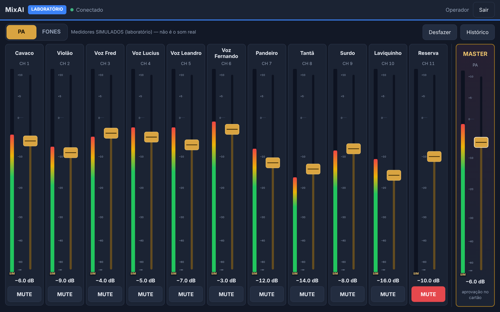
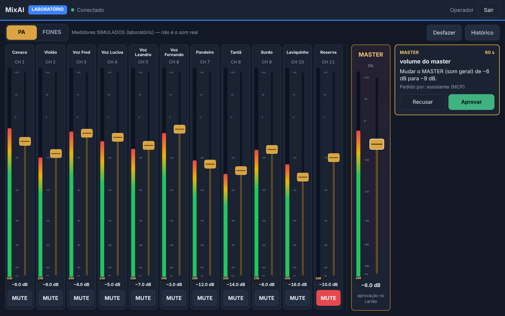
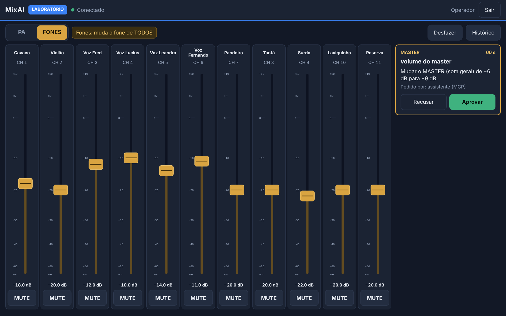
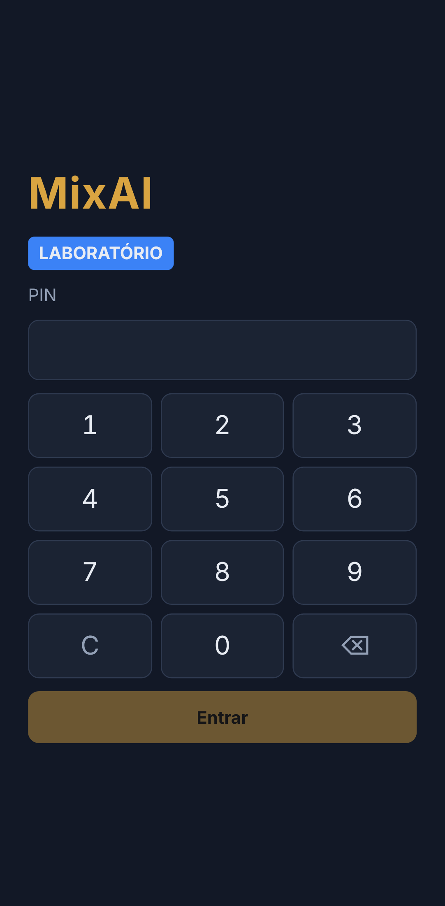
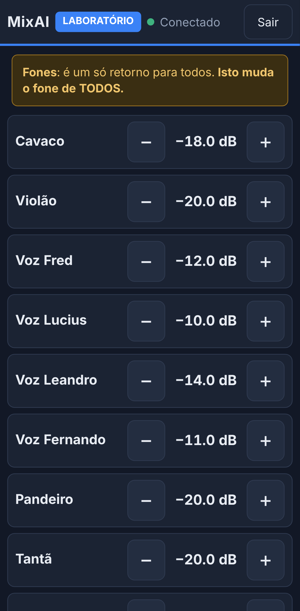
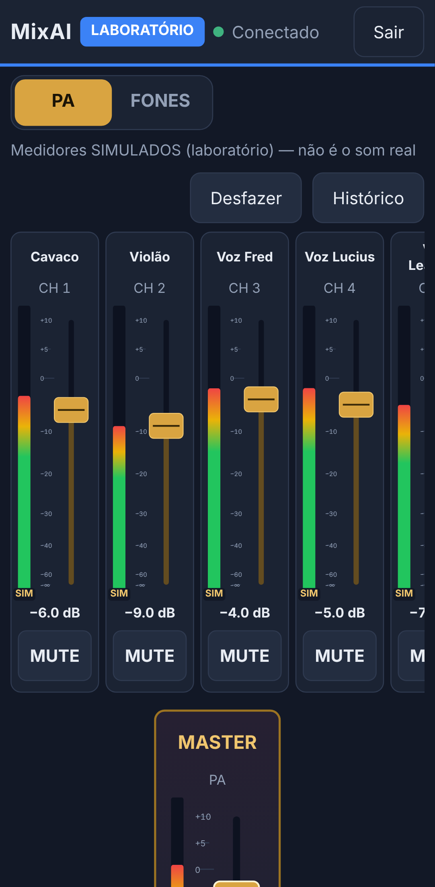

# 07 — E3: interface visual (Angular)

**Data:** 05/11/2026 · **Versão:** 0.5.0 · **Branch:** `e3-angular-ui` · Base: `main` após o merge da E2 (`aee1c01`).

## Resumo

- Interface web em **Angular 22** (standalone, sem zone.js, com signals), em `web/`.
  - O build vai para `dist/web` e é servido pelo **próprio servidor** da E2.
  - Não há outro servidor, e a tela não fala com a Soundcraft: só com a API e o WebSocket da E2.
- **Mesa** (operador, Yoga):
  - strips com os nomes reais da banda, fader e medidor em SVG próprio, valor em dB e MUTE;
  - **master** separado e destacado;
  - alternância **PA | FONES**;
  - Desfazer e Histórico;
  - cartões de aprovação.
- **Fones** (músico, celular):
  - lista com **− / +** de 2 dB no AUX 1;
  - aviso fixo de que o retorno é de todos.
- **PIN** com teclado numérico. O perfil vem do servidor, e toda alteração passa pela autorização da E2.
- **Sincronização ao vivo:**
  - snapshot e eventos com revisões;
  - ressincronização quando um evento se perde;
  - reconexão automática;
  - indicador claro de conexão e do estado da mesa.
- Validação funcional **só no LAB**. Não há LAB → REAL.

### Capturas

| Yoga (1536×960, toque) | |
| --- | --- |
|  |  |
| Mesa no PA, medidores simulados marcados "SIM", Reserva mutado | Pedido do assistente para o master: cartão com Aprovar/Recusar |
|  | |
| FONES: os mesmos faders no AUX 1, aviso "muda o fone de TODOS" | |

| Celular (Pixel 7) | | |
| --- | --- | --- |
|  |  |  |
| Entrada por PIN | Músico: só fones, − / + | Operador no celular: canais com rolagem lateral |

As capturas são geradas com `npm run screenshots` (laboratório, nomes do `config/channels.yaml`).

## Como usar (LAB)

```bash
npm ci && npm ci --prefix web
npm run build && npm run build:web
npm run pin -- operador        # e, se quiser, npm run pin -- musico
npm run serve:lab
```

- **No Yoga:** abra `http://127.0.0.1:8790`, digite o PIN e use a Mesa.
- **No celular:**
  1. configure `server.lan` com o IP do **Wi-Fi do notebook** (passo a passo em `06-E2-SERVIDOR.md`);
  2. abra `http://<ip-do-wi-fi>:8790` e entre com o PIN do músico.
- Valem os mesmos cuidados de rede da E2: sem TLS, PIN e token podem ser capturados por quem estiver no mesmo Wi-Fi. Use uma rede da banda, privada.
- **Desenvolvimento da tela:** `npm run serve:lab` num terminal e `npm --prefix web start` em outro, com o proxy para a 8790 já configurado.

## Mudança no servidor: arraste de fader

O plano de arquitetura (`02`, "Arraste de fader") prevê que um arraste conte como um comando só. Os comandos discretos (IA e botões) têm limite de 5 por segundo e confirmação para passo grande. Se cada valor do arraste fosse um comando, um arraste de 30 dB viraria pendência e bateria no limite.

**O que foi implementado:**
- **Comando `fader`, só por WebSocket e só para pessoas.**
  - O operador pode arrastar qualquer canal.
  - O músico só o AUX 1, pela autorização da E2.
  - O assistente é recusado.
- **Coalescência:** enquanto uma escrita do arraste está em andamento, os valores seguintes são juntados e só o mais recente é escrito.
  - A tela manda no máximo ~30 valores por segundo.
- **Um arraste conta como um comando:**
  - **um** comando no limite por segundo;
  - **um** item no desfazer, feito pelo operador. Se o assistente quiser desfazer, vira cartão (E2).
- **Passo grande:** o arraste **não** pede confirmação, porque é a mão da pessoa no fader. Continua valendo:
  - o **teto de volume**;
  - o estado da ligação (sem conexão, somente leitura...);
  - a fila única;
  - a invalidação de pendências pelas revisões.
- **O master não tem arraste.**
  - Arrastar o fader do master só escolhe o valor.
  - Ao soltar, vira `set_master`: sempre um **cartão** que o operador precisa aprovar.
  - Teclado no master: cada tecla gera um cartão.
- **Tela que cai no meio do arraste:** o gesto é fechado e vira um item no desfazer.

## Arquitetura da tela

| Arquivo | Papel |
| --- | --- |
| `web/src/app/core/protocol.ts` | formato de transmissão da E1 e sincronização (`StateSync`), espelhando `src/client/state-sync.ts` |
| `web/src/app/core/live.service.ts` | WebSocket: autenticação por mensagem, snapshot/eventos, reconexão (0,5 s → 5 s), pendências, medidores, pedidos presos ao `serverId` |
| `web/src/app/core/session.service.ts` | login por PIN; token só na aba (`sessionStorage`), nunca na URL; sessão recusada → tela de PIN com aviso |
| `web/src/app/core/actions.service.ts` | botões ocupados e retorno imediato (avisos); um id por arraste |
| `web/src/app/core/db.ts` | escala do fader (dB ↔ posição, mais resolução perto de 0 dB, −∞ no fundo) |
| `web/src/app/ui/fader.component.ts` | fader SVG: arraste relativo, pointer events, `touch-action: none`, teclado, ARIA de slider |
| `web/src/app/ui/meter.component.ts` | medidor SVG; marcado **SIM** quando simulado |
| `web/src/app/ui/strip.component.ts` | um canal (nome, medidor, fader, dB, MUTE) |
| `web/src/app/ui/pending-cards.component.ts` | cartões: tipo, título, impacto, quem pediu, contagem regressiva, Aprovar/Recusar |
| `web/src/app/views/*` | PIN, Mesa (operador), Fones (músico) |

**Decisões de interação:**
- **Arraste relativo:**
  - tocar no trilho não faz o fader pular, só arrastar move (evita mudança acidental no palco);
  - durante o arraste a tela mostra o valor da mão; ao soltar volta a mostrar o do servidor. Se o servidor recusar, o fader volta sozinho.
- **PA ↔ FONES** só troca a vista, por toque no seletor. Nunca por gesto, e nunca envia comando (testado).
- **Celular:**
  - FONES é uma lista com − / + de 2 dB, sem fader (como no plano);
  - o operador no celular vê os canais com rolagem lateral só na fileira; a página não rola para o lado.
- **Teclado:**
  - ↑/↓ mudam 1 dB, PageUp/PageDown 5 dB, Home vai para 0 dB e End para −∞;
  - foco visível em latão.
- **Visual:**
  - tema escuro azul-noite com destaque latão;
  - fonte do sistema (Bahnschrift no Windows do Yoga, condensada), sem fonte da internet, porque o show pode não ter internet;
  - alvos de toque de 48 px ou mais;
  - respeita `prefers-reduced-motion`.
- **Nomes:** os nomes da banda aparecem completos. Os longos quebram só entre palavras, e o tamanho acompanha a largura do canal.

## Segurança

- **CSP restrita** nas páginas da interface: script, estilo, imagem e conexão só do próprio servidor (`connect-src 'self' ws: wss:`), além de `frame-ancestors 'none'`, `nosniff` e `no-referrer`.
  - O "CSS crítico em linha" do Angular foi desligado, porque a CSP bloqueia o `onload` em linha.
- **A tela só esconde botões. Quem decide é o servidor:**
  - o teste de integração burla a tela do músico e manda `set_master` e um arraste no PA pelo próprio WebSocket;
  - os dois são recusados com `FORBIDDEN`.
- **Pedidos da tela:** levam o `serverId`. Se o servidor reiniciar, o pedido é recusado sem executar.
  - Resposta perdida → aviso de "pode ter sido aplicada; confira" (sem repetir).
- **Ids aleatórios:** usam `crypto.getRandomValues`, que funciona no celular em HTTP; o `randomUUID` exige HTTPS.

## Testes

| Conjunto | Quantidade | Comando |
| --- | --- | --- |
| Servidor e núcleo (E0–E2 + gesto de fader) | 232 | `npm test` |
| Interface, unitários (Vitest via Angular) | 27 | `npm run test:web` |
| Integração com navegador (Chromium + servidor LAB) | 10 | `npm run test:e2e` |

- Os testes de integração passaram 5 vezes seguidas.
- No CI, a interface é testada e construída no Ubuntu e no Windows; a integração com navegador roda no Ubuntu.

| Exigência | Onde |
| --- | --- |
| dois dispositivos sincronizados | e2e: Yoga (operador) × celular (músico), nos dois sentidos |
| fader por toque e arraste | e2e: eventos de **toque reais** do Chromium e mouse; unitário: arraste, toque sem pulo, −∞, teclado |
| PA/FONES sem alterar valores | e2e: estado do servidor idêntico após 8 trocas; unitário: nenhuma mensagem enviada |
| músico impedido de controlar o PA | e2e: tela sem PA/master, e servidor recusa a tela burlada; unitário: só a tela Fones |
| confirmação de operação crítica | e2e: master → cartão → Aprovar; assistente → cartão → Recusar; expirada some com aviso; unitário: approve com pendingId, invalidada |
| reconexão e atualização do estado | e2e: conexão derrubada, mudança enquanto fora, tela volta com o valor novo; servidor reiniciado → PIN; unitário: reconexão e 4401 |
| comportamento responsivo | e2e: 11 canais no Yoga sem rolagem, celular sem rolagem lateral, botões ≥ 48 px |
| gesto no servidor | `test/fader.test.ts`: arraste de 30 dB sem pendência, um desfazer, coalescência, teto/−∞, músico, assistente, queda no meio |

## Riscos remanescentes

| Risco | Impacto | Mitigação |
| --- | --- | --- |
| Toque no Windows do Yoga não testado no aparelho | arraste pode se comportar diferente da emulação | `pointer events` + `touch-action: none` (padrão do Windows 10/11); testar no Yoga antes do ensaio |
| Arraste não pede confirmação de passo grande | um gesto pode mudar muito de uma vez | é a mão do operador; teto de volume mantido; um desfazer volta o gesto inteiro; master fora do arraste |
| Fonte Bahnschrift só no Windows | no celular a fonte cai para a condensada do sistema (ou sans) | aparência quase igual; nada depende da fonte |
| Sessão só na aba (`sessionStorage`) | fechar a aba do celular pede o PIN de novo | escolha de segurança; recarregar a página mantém a sessão |
| Sem TLS na rede local | PIN e token podem ser capturados por quem estiver no mesmo Wi-Fi | ver `06-E2-SERVIDOR.md`: só localhost por padrão; rede privada dedicada |
| Medidores simulados | podem ser confundidos com som real | marcados "SIM" em cada canal e com legenda; na mesa real não há medidores até a E6 |

## Fora do escopo

- Assistente por API (E4).
- Voz.
- EQ visual (E7).
- LAB → REAL.
- Medidores reais (E6).
- Novos controles da Ui16.
