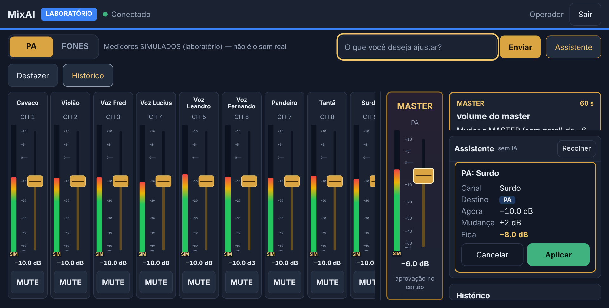
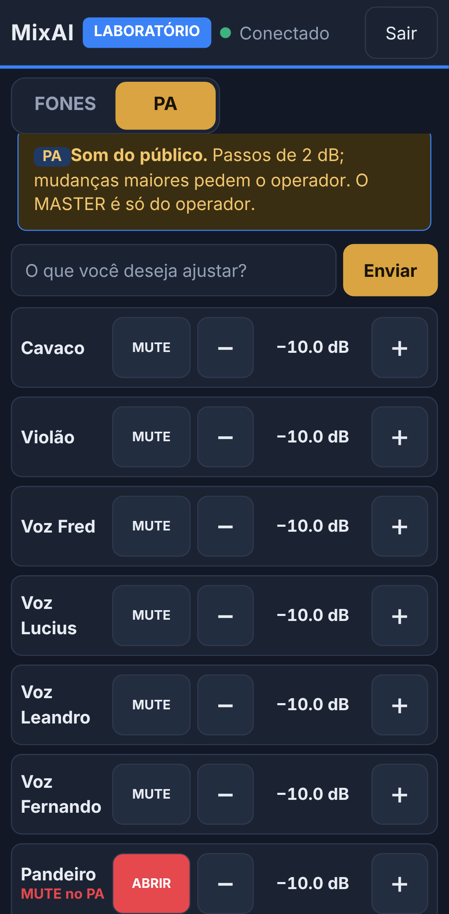

# Ajustes do teste no Yoga: chat do operador, permissões, configuração local

Branch `fix/e4-yoga-permissions`. Ajustes depois do teste da E4 no Lenovo Yoga e no celular, em modo **LABORATÓRIO**, com a `main` em `42baf56`. Não inicia a E5.

| # | Ajuste | Estado |
| --- | --- | --- |
| 1 | Chat do operador nunca fica em silêncio | corrigido |
| 2 | Permissões do músico configuráveis (`fones_only` / `pa_without_master`) | implementado; padrão continua `fones_only` |
| 3 | `config/config.local.yaml` fora do Git | implementado |
| 4 | `npm run pin` com entrada não interativa | mensagem clara, nada gravado |
| 5 | Roteiro de rede no Windows | `06-E2-SERVIDOR.md`, seção "Conectar um segundo dispositivo" |

## 1. Chat do operador

**Causa (reproduzida no navegador, no tamanho de tela do Yoga):** o servidor respondia normalmente e o cartão era desenhado, mas **fora da área visível**. Não era autenticação.

- Com cartões de aprovação pendentes ou o histórico aberto, o painel do assistente ficava no fim da coluna lateral, que só aparece rolando. No Yoga a 150% (1280×650 úteis) com 3 aprovações, a resposta ficava **0% visível**.
- No Yoga em retrato, ou com escala de 175–200% (largura ≤ 720 px), o painel ficava **abaixo dos faders**.
- Durante uma queda, o botão Enviar ficava desabilitado sem explicação, e um pedido interrompido aparecia como "sem resposta", sem dizer se tinha saído.

**Correções:**
- **Coluna lateral:** com o assistente aberto, aprovações (até 30%, rolagem própria), assistente (mínimo 300 px) e histórico (até 20%) dividem a altura. A mensagem nova é sempre trazida para a tela, dentro da conversa e na página. Quando não cabe inteira, aparece o começo dela.
- **Botão desabilitado só com o motivo escrito ao lado:**
  - "Sem conexão com o servidor — reconectando. Nada é enviado enquanto isso."
  - "Esperando a resposta do pedido anterior…"
  - Com o campo vazio, Enviar explica "Escreva o que você deseja ajustar."
- **O campo nunca bloqueia:** sem conexão, o texto fica no campo e só sai quando o pedido é de fato enviado.
- **Nada é repetido automaticamente:**
  - pedido não enviado: "o pedido NÃO foi enviado e nada mudou na mesa";
  - resposta perdida: "o pedido não será repetido automaticamente";
  - Aplicar sem conexão: nada foi aplicado, e o cartão continua disponível;
  - Aplicar com a resposta perdida: "PODE ter sido aplicado", sem repetir.
- **Volta ao PIN explicando o motivo.** Antes de fechar com 4401, o servidor manda `error {code: UNAUTHORIZED, reason}`:

| Motivo | Mensagem |
| --- | --- |
| `expired` | Sua sessão venceu (vale 12 horas)… |
| `logout` | Sua sessão foi encerrada (alguém tocou em Sair com esta sessão)… |
| sessão desconhecida e **outra instância** do servidor | O servidor do MixAI foi reiniciado… Pedidos que estavam em andamento não foram repetidos. |
| sessão desconhecida, mesma instância | O servidor não reconheceu mais esta sessão… |

- Ao trocar de sessão, a conversa e os cartões antigos somem. Resposta fora do formato vira aviso visível, nunca silêncio.



## 2. Permissões do músico

Configuração em `server.musicianAccess`. O padrão é **`fones_only`**, e nada muda sem configurar. Para ativar só numa máquina, use o `config/config.local.yaml`:

```yaml
server:
  musicianAccess: pa_without_master
  # musicianPaStepDB: 3   # 0,5 a 3 dB; mais que 3 é recusado na leitura da configuração
```

| Ação do músico | `fones_only` | `pa_without_master` |
| --- | --- | --- |
| Ver e ajustar os FONES (AUX dos músicos), inclusive arrastando | sim | sim |
| Ver os valores dos canais no PA | não | sim (volume e mute; nunca o master nem EQ/HPF) |
| Volume de um canal no PA | não | passos de até **3 dB** (relativo **ou absoluto**). Acima: cartão de aprovação do operador; só aplica depois do "Aprovar" |
| Arrastar fader do PA | não | **não** (um gesto pode cruzar dezenas de dB) |
| MUTE no PA | não | um canal por vez |
| MASTER | não | **não** |
| Cenas/snapshots, desfazer, histórico, reset | não | não |
| Aprovar pendências (inclusive a própria) | não | não |
| Ganho, phantom, EQ e outros parâmetros físicos | não existem no esquema de comandos | idem |

**Onde é conferido:** tudo no servidor (`src/server/policy.ts`, `authorizeCommand`, `ServerCore.fader`, `MixController.setLevel`). Vale para WebSocket e HTTP, inclusive mensagens forjadas.
- O limite de 3 dB usa o **mesmo cálculo das travas** do controlador (com −∞ contando como −60 dB). É calculado **dentro da fila**, sobre o valor atual.
- Na aprovação, o servidor reaplica o mesmo limite ao comando original.
- A consulta `mix_state` do PA não devolve o master ao músico.

**Celular:**
- No modo `pa_without_master` aparecem as abas **FONES** e **PA**, com selo e aviso próprios ("Som do público. Passos de 2 dB; mudanças maiores pedem o operador. O MASTER é só do operador.").
- No PA há − / + e MUTE por canal, sem fader e sem master.
- No modo `fones_only` a tela é a mesma de antes.



**Assistente:**
- Com os dois destinos, o parser **pergunta "PA ou FONES?"** em vez de presumir os fones. No `fones_only` continua indo para os FONES.
- Propostas maiores que 3 dB no PA mostram "precisa da aprovação do operador". Depois de Aplicar, viram cartão para o operador.
- O contexto da IA só traz o que o perfil pode ver: no `pa_without_master`, os canais do PA e dos fones; no `fones_only`, só os fones. O master nunca aparece. O texto de regras da IA diz o que o músico pode pedir.

**Quem fez cada alteração:**
- O histórico grava **perfil + sessão** em `details.by`, por exemplo `músico · sessão 3fa2c1`.
- Numa aprovação, grava `músico · sessão 3fa2c1; aprovado por operador · sessão 9b04de`.
- Os cartões de aprovação mostram o mesmo texto em "Pedido por".
- O PIN do músico é **compartilhado**, então a sessão identifica um login ou aparelho, não uma pessoa. O PIN nunca aparece no log.

O operador e o assistente MCP continuam com a autorização de antes (testado).

## 3. Configuração local (`config/config.local.yaml`)

- Fica na mesma pasta do `config.yaml` e está no `.gitignore`. O modelo é `config/config.local.example.yaml`.
- **Só os campos declarados mudam:**
  - objetos são mesclados campo a campo;
  - valores simples e listas substituem;
  - o resto continua vindo do `config.yaml`.
- **Precedência (o de baixo vence):** `config.yaml` < `config.local.yaml` < variáveis de ambiente (`MIXAI_MODE`, `MIXAI_IP`, `MIXAI_PORT`, `MIXAI_LAN_HOST`…) < argumentos (`--lab`, `--real`…).
- **Segredos são recusados** (PIN, hash de PIN, chave da API): o servidor não sobe e aponta o campo. Eles continuam em `config/secrets.yaml` ou no ambiente.
- Valor inválido gera um erro que cita o `config.local.yaml`. Ao subir, o servidor mostra `configuração local aplicada: …`.
- O `config/channels.yaml` (nomes da banda) não foi alterado.

**Migração no Yoga sem perder o IP e as preferências:** passo a passo em `06-E2-SERVIDOR.md`, "Migrar uma configuração local antiga". Em resumo:
1. `git diff config/config.yaml` para ver o que foi mudado.
2. Copiar esses valores para o `config.local.yaml`.
3. `git checkout -- config/config.yaml`.
4. `git pull`.

## 4. `npm run pin`

- **Sem terminal interativo** (pipe, arquivo, tarefa agendada), o comando sai com código 2 e explica que precisa de um terminal interativo, que o PIN nunca é aceito por argumento, arquivo ou pipe, e como rodar no PowerShell. **Nada é gravado.**
- **Ctrl+D antes do PIN:** "Nada foi gravado."
- Grava só o hash scrypt. O PIN não aparece na tela, na saída nem no arquivo (testado).

## 5. Rede no Windows

O roteiro do Yoga fica em `06-E2-SERVIDOR.md`:
- como descobrir o IPv4 do Wi-Fi;
- como reservar o IP no roteador (com o MAC do Wi-Fi);
- o `config.local.yaml`;
- a rede como **Privada** e a regra de firewall, que **exigem PowerShell como administrador**;
- o teste no celular.

```powershell
New-NetFirewallRule -DisplayName "MixAI LAB" -Direction Inbound -Protocol TCP -LocalPort 8790 -Profile Private -Action Allow
Set-NetFirewallRule -DisplayName "MixAI LAB" -RemoteAddress LocalSubnet   # recomendado: só a rede local
```

Nenhum IP fica no código: o do Wi-Fi vem do `config.local.yaml` ou de `MIXAI_LAN_HOST`.

## Testes

| Conjunto | Total | Novos nesta rodada |
| --- | --- | --- |
| Servidor e núcleo (`npm test`) | 311 | 28: 16 de permissões (dois modos, WebSocket/HTTP forjados, aprovação, histórico, parser, contexto da IA) + 12 de configuração local e PIN |
| Interface, unitários (`npm run test:web`) | 43 | 7: motivo do botão, texto preservado, pedido não repetido, resposta vazia, conversa limpa, mensagens de sessão |
| Integração com navegador (`npm run test:e2e`) | 27 | 12: 9 do operador (Yoga 125% e 150% com aprovações, retrato, campo vazio, queda, pedido em andamento, servidor reiniciado, sessão vencida, Sair em outra aba) + 3 do celular do músico (dois modos, aprovação) |

Os testes das etapas anteriores foram mantidos. Só mudou o texto esperado do aviso de servidor reiniciado, agora mais específico.

## Riscos remanescentes

| Risco | Efeito | Mitigação |
| --- | --- | --- |
| Músico com PA dando vários passos de 3 dB seguidos | sobe bastante em poucos toques | cada passo é um comando: limite de comandos por segundo, histórico com sessão, operador vê tudo e pode desfazer. Um teto por janela de tempo pode vir depois, se o uso mostrar necessidade |
| PIN do músico compartilhado | não identifica a pessoa | o histórico registra a sessão (aparelho/login); PIN trocável com `npm run pin` |
| HTTP sem TLS na rede local | PIN e token capturáveis no mesmo Wi-Fi | rede privada e confiável; regra de firewall só em rede Privada e na sub-rede local (ver `06-E2-SERVIDOR.md`) |
| Validação só no LAB | comportamento na mesa real não verificado nesta rodada | nada aqui depende do modo; o teste na mesa real continua pendente |
