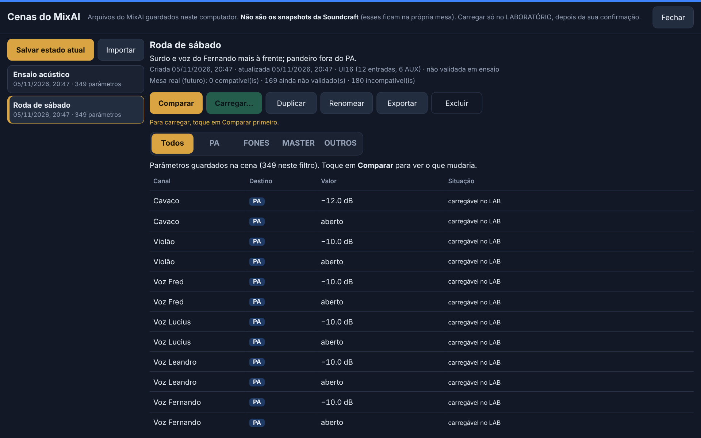
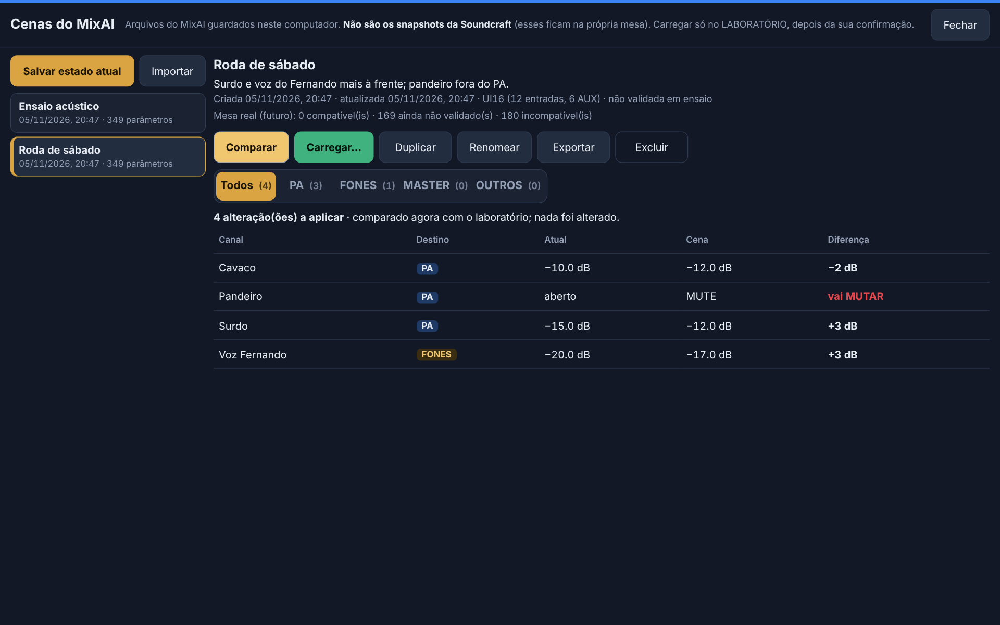
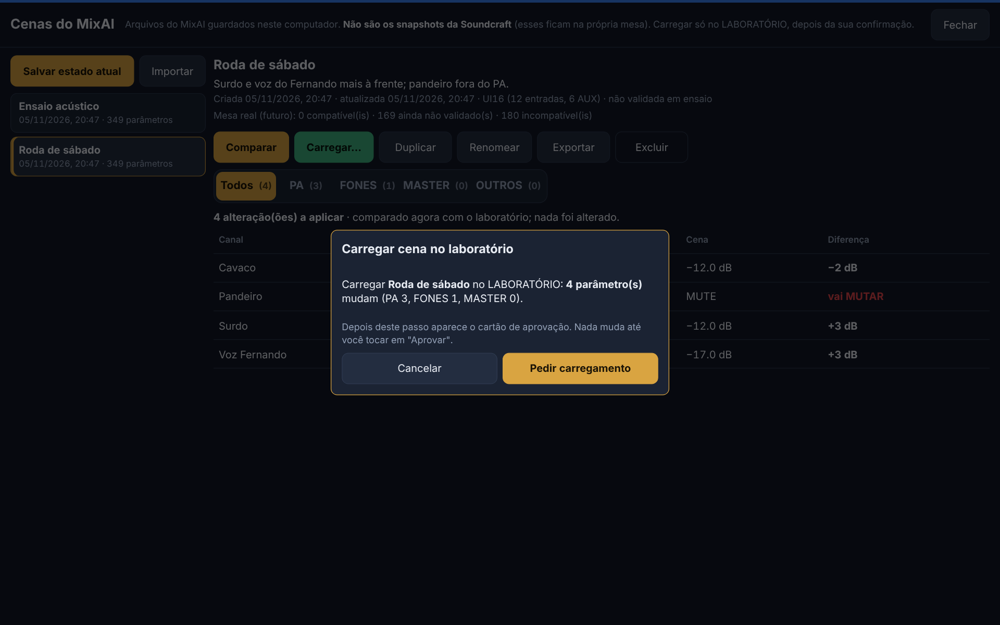
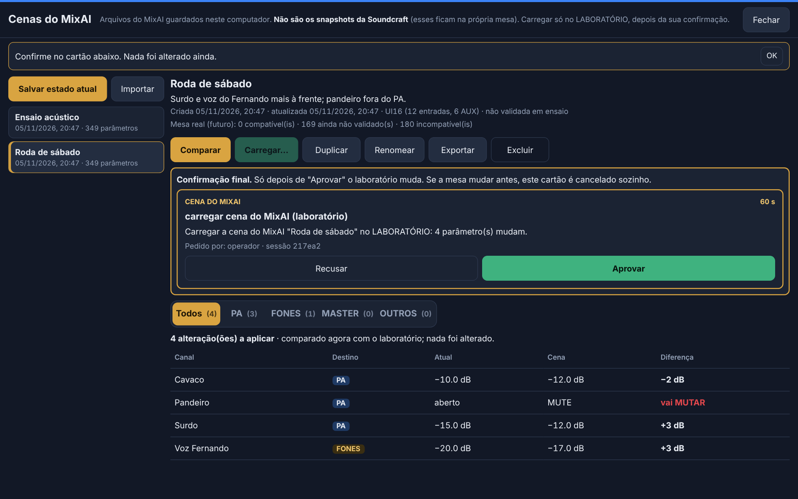

# E5 — Cenas do MixAI no laboratório

Branch `e5-lab-scenes`. Referência: `03-IMPLEMENTATION-PLAN.md`, seção E5. **Tudo só no LABORATÓRIO**: nenhuma cena é enviada à Ui16 real.

> **Regra fundamental:** nenhuma cena altera a mesa sem confirmação humana.

## O que é uma cena do MixAI

| | Cena do MixAI | Snapshot da Soundcraft |
| --- | --- | --- |
| Onde fica | arquivo no computador: `data/scenes/<id>.json` (fora do Git) | na própria mesa Ui16 |
| Quem cria | o operador, pela área **Cenas** | a interface da Soundcraft |
| Carregar | só no LABORATÓRIO, com comparação e aprovação | `load_snapshot` (E2), sempre com aprovação |
| Desfazer | sim, uma operação | não (o desfazer é zerado) |

A tela de Cenas mostra a diferença no topo: "Arquivos do MixAI guardados neste computador. **Não são os snapshots da Soundcraft**".

## Funcionalidades

- Criar cena a partir do estado atual do laboratório, com nome e descrição do usuário.
- Listar, duplicar (`"Nome (cópia)"`), renomear e trocar a descrição. Os nomes não se repetem (sem diferenciar maiúsculas).
- Excluir com confirmação. O servidor confere o nome atual da cena, e o arquivo é **movido** para `data/scenes/excluidas/`, de onde dá para recuperar à mão.
- Ver os parâmetros salvos, por destino.
- Comparar com o estado atual e carregar no LAB, depois da aprovação.
- Exportar (download `mixai-cena-<nome>.json`) e importar (seletor de arquivo, até 256 KB).

`config/channels.yaml` e os nomes dos canais não são alterados.

## Formato do arquivo (`schemaVersion: 2`)

```json
{
  "schemaVersion": 2,
  "kind": "mixai-scene",
  "id": "cena-3f9a1c2b7d4e",
  "name": "Roda de sábado",
  "description": "Surdo e voz do Fernando mais à frente",
  "createdAt": "2026-11-05T20:43:00.000Z",
  "updatedAt": "2026-11-05T20:43:00.000Z",
  "deviceProfile": { "model": "ui16", "inputs": 12, "aux": 6 },
  "validationStatus": "UNVERIFIED",
  "source": { "mode": "lab", "app": "MixAI" },
  "params": {
    "ch.9.main.level": { "value": -12, "status": "unknown" },
    "ch.8.main.level": { "value": "-inf", "status": "unknown" },
    "ch.7.main.mute": { "value": true, "status": "unknown" },
    "ch.1.eq.b1.gain": { "value": 0, "status": "incompatible" }
  }
}
```

- **Identificadores estáveis:** as chaves são os mesmos `ParamKey` do resto do projeto (`ch.N.main.level`, `ch.N.aux.A.mute`, `master.level`, `ch.N.eq.bK.gain`…).
- **−∞:** é gravado como `"-inf"`, porque JSON não tem Infinity. Volta como `-Infinity` sem perda (testado na ida e volta entre dois computadores).
- **Validação com Zod:**
  - o esquema é estrito: campo desconhecido é recusado;
  - cada valor é conferido na faixa do registro de parâmetros;
  - nome com até 60 caracteres e descrição com até 500;
  - no máximo 2000 parâmetros.
- **`validationStatus`:** `UNVERIFIED` (só laboratório) ou `VALIDATED_IN_REHEARSAL` (ouvida num ensaio; reservado para depois).
- **Status por parâmetro** (preparação para a comparação com a Ui16 real, D9):

| Status | Quando |
| --- | --- |
| `compatible` | parâmetro validado na mesa física (`hardware_verified`; nenhum ainda) |
| `unknown` | existe na biblioteca da Soundcraft, ainda não validado na mesa física (volume e mute hoje) |
| `incompatible` | só existe no laboratório ou não é enviado à mesa real (EQ, HPF, bypass hoje) |

## Importação

- **Recusada com mensagem:**
  - JSON inválido;
  - arquivo que não é cena do MixAI (inclusive um snapshot da Soundcraft);
  - campo desconhecido;
  - valor fora da faixa ou do tipo errado;
  - identificador de parâmetro inválido;
  - **versão de formato diferente de 2** (mais nova: "atualize o MixAI");
  - **outro modelo de mesa** (`DEVICE_MISMATCH`, por exemplo uma cena da Ui24).
- **Aceita com aviso:** mesmo modelo com outro número de entradas ou AUX. Os parâmetros que não existem aqui ficam guardados e nunca são aplicados.
- **Sempre cria uma cena nova:** id novo, e um nome livre se já houver um igual (`"Show (importada)"`). **Nunca sobrescreve e nunca aplica nada.**

## Comparação

Mostra **só o que difere** do estado atual, com o total de alterações e os filtros **Todos / PA / FONES / MASTER / OUTROS**:

| Canal | Destino | Atual | Cena | Diferença |
| --- | --- | --- | --- | --- |
| Surdo | PA | −15.0 dB | −12.0 dB | **+3 dB** |
| Cavaco | PA | −10.0 dB | −12.0 dB | **−2 dB** |
| Voz Fernando | FONES | −20.0 dB | −17.0 dB | **+3 dB** |
| Pandeiro | PA | aberto | MUTE | vai MUTAR |
| Voz Fred | EQ | 0 | −4 | não aplicável: EQ/HPF, guardado na cena |

- **Volume:** diferença em dB.
- **Mute:** "vai MUTAR" ou "vai ABRIR".
- **Ainda não aplicável:**
  - EQ, HPF e bypass (sem caminho de escrita novo);
  - canais e AUX fora do `channels.yaml`;
  - valor atual desconhecido.
- **Teto de segurança:** um volume acima do teto (`safety.maxChannelLevelDB` etc.) aparece como "→ 0.0 dB (teto)", e é esse o valor aplicado.

Comparar não altera nada e guarda uma **prévia** presa às revisões dos parâmetros da cena (vale 5 min, uma vez).

## Carregamento seguro

1. O operador escolhe a cena.
2. **Comparar:** o servidor calcula as diferenças e guarda a prévia, com as revisões dos parâmetros.
3. A tela mostra a prévia, e **Carregar…** abre o resumo ("N parâmetros mudam: PA x, FONES y, MASTER z").
4. **Pedir carregamento:**
   - o servidor confere a prévia **dentro da fila única**;
   - se qualquer parâmetro mudou, responde `STATE_CHANGED` e a tela pede nova comparação.
5. O servidor cria a **pendência de aprovação da E2**. É o mesmo mecanismo dos cartões de master e snapshot; não existe um segundo sistema. Ela fica vinculada:
   - às **revisões de todos os parâmetros aplicáveis da cena**;
   - ao **conteúdo da cena** (hash dos valores e do equipamento).
6. O operador toca em **Aprovar** no cartão, dentro do painel de Cenas ou na coluna lateral da Mesa.
7. Só então o LAB aplica, pela **fila única**, com as travas existentes.

**Garantias:**
- **A mesa mudou entre o pedido e a aprovação:** a pendência é **invalidada na hora**. O cartão some com "a pendência foi invalidada", e a mudança posterior **não é sobrescrita**. Isso também vale agora para os outros cartões (master, passo grande), porque a pendência confere as revisões a cada segundo.
- **A cena foi excluída antes da aprovação:** nada é aplicado (`NOT_FOUND`).
- **Ordem segura de aplicação:** primeiro o que diminui o som (mutar, abaixar), depois o que aumenta (subir, abrir). Evita um pico no meio da troca.
- **Sem saltos sem aviso:** todo carregamento tem prévia e aprovação, qualquer que seja o tamanho da mudança.
- **Uma prévia, um pedido.** A prévia vale 5 minutos e só para o operador que comparou.

## Desfazer e falhas

- **Desfazer:**
  - o carregamento entra como **um item** no histórico (`scene_load`, com `by: operador · sessão …; aprovado por operador · sessão …`) e **um item** na pilha de desfazer;
  - um toque em **Desfazer** volta todos os parâmetros;
  - o desfazer respeita as revisões: o que alguém mudou depois da cena não é sobrescrito, pela política existente.
- **Falhas:**
  - uma falha no meio da aplicação gera `PARTIAL`, com "Operação PARCIAL", "RESULTADO INCERTO" e "NÃO enviado";
  - **nunca** é apresentada como sucesso completo;
  - só o que foi de fato enviado entra no desfazer.

## Permissões (conferidas no backend)

| Ação | Operador | Músico (qualquer modo, inclusive `pa_without_master`) | Assistente (MCP e tela) |
| --- | --- | --- | --- |
| Criar, renomear, duplicar, excluir, ver | sim | **não** | **não** |
| Importar e exportar | sim | não | não |
| Comparar e pedir carregamento | sim (só LAB) | não | não |
| Aprovar o carregamento | sim | não | não |

O botão **Cenas** só aparece na tela do operador. Comandos `scene_*` forjados por WebSocket ou HTTP são recusados (`FORBIDDEN`, testado).

## Nunca na mesa real

- O `ScenesService` só compara, salva do estado e carrega quando o servidor **e** o adaptador da mesa estão em modo `lab`.
- O `MixController.loadScene` confere de novo e recusa qualquer outro modo (`MODE_MISMATCH`), mesmo chamado direto e mesmo com uma confirmação.
- Fora do LAB, a tela mostra "Fora do laboratório: só ver, renomear, importar e exportar".
- EQ e HPF continuam sem caminho de escrita física.

## Interface

**Cenas** é um botão na barra da Mesa. Abre um painel em tela cheia, que se fecha com **Fechar** e não ocupa os faders de forma permanente:
- lista à esquerda, com **Salvar estado atual** e **Importar**;
- detalhes à direita, com **Comparar**, **Carregar…**, **Duplicar**, **Renomear**, **Exportar** e **Excluir**;
- filtros por destino;
- diálogos de confirmação.

Os botões têm pelo menos 48 px de altura (toque no Yoga). Em tela estreita, a lista fica acima dos detalhes, sem rolagem horizontal. "Carregar…" desabilitado sempre mostra o motivo.






## Arquivos

| Arquivo | O quê |
| --- | --- |
| `src/core/scene.ts` | formato v2, validação, status, classificação, comparação, alvos de carregamento |
| `src/core/scene-store.ts` | `data/scenes/`: gravação atômica, nomes, duplicar, renomear, excluir, importar, exportar |
| `src/server/scenes.ts` | serviço do servidor: comandos, prévia, pedido, aplicação aprovada |
| `src/core/controller.ts` | `loadScene` (fila única, aprovação, desfazer, ordem segura, só LAB) |
| `src/core/pending.ts` | pendência invalidada na hora quando um parâmetro vinculado muda |
| `src/server/commands.ts`, `core.ts` | comandos `scene_*`, autorização só do operador, aprovação |
| `web/src/app/scenes/*` | tela de Cenas |

## Testes

| Conjunto | Total | Novos na E5 |
| --- | --- | --- |
| Servidor e núcleo (`npm test`) | 332 | 21 de cenas (+ 2 da E1 adaptados ao formato v2) |
| Interface, unitários (`npm run test:web`) | 46 | 3 |
| Integração com navegador (`npm run test:e2e`) | 33 | 6 |

Cobertura dos 16 itens pedidos:
1. Criar e salvar.
2. Persistir depois de reiniciar.
3. Duplicar e renomear.
4. Exportar e importar entre **dois computadores independentes**: dois servidores com pastas de dados diferentes, arquivo levado por uma pasta "pendrive". Testado no servidor e no navegador, com download e seletor de arquivo.
5. JSON inválido.
6. Versão incompatível.
7. Equipamento incompatível.
8. Diferenças.
9. Importar sem aplicar.
10. Carregar só depois da aprovação.
11. Aprovação invalidada quando o estado muda, antes do pedido e entre o pedido e a aprovação.
12. Músico impedido nos dois modos.
13. Mesa REAL impedida (serviço e controlador, nenhuma escrita).
14. Desfazer como uma operação.
15. Proteções anteriores: tetos, falha parcial, aprovação só do operador, assistente recusado, e todos os testes anteriores verdes.
16. Interface no tamanho do Yoga (125%) e em retrato, no Chromium, sem erros de JavaScript.

Mutações conferidas: sem a aprovação obrigatória, 5 testes falham; sem a conferência da prévia, o teste de "estado mudou" falha.

## Riscos e limites

| Item | Situação |
| --- | --- |
| EQ/HPF na cena | guardados e comparados, **não aplicados** (sem caminho de escrita novo). A E7 decide |
| Cena com canais fora do `channels.yaml` | guardados, mostrados como não aplicáveis |
| Comparação LAB × Ui16 real | só o formato está preparado (status por parâmetro). A comparação é a E8 |
| Arquivo editado à mão em `data/scenes` | validado ao ler; arquivo ilegível é listado como ignorado e não é apagado |
| Exclusão | move para `data/scenes/excluidas/`; não há lixeira na tela |
