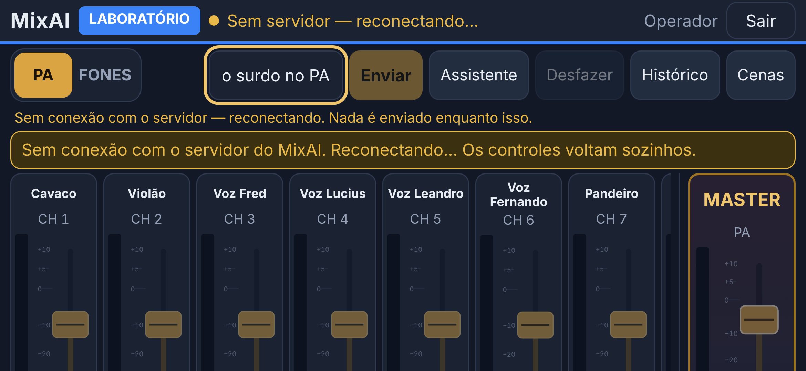
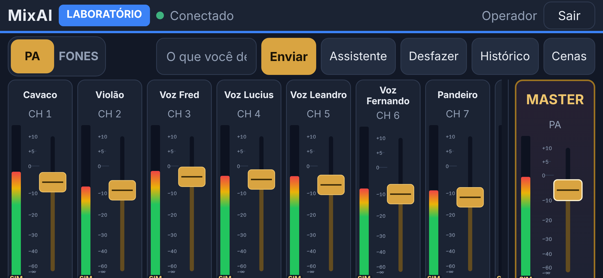
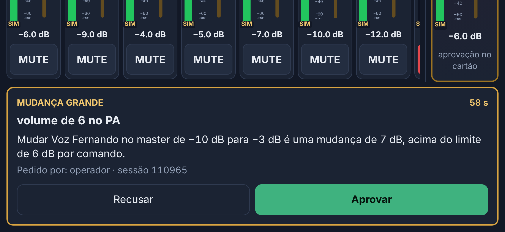
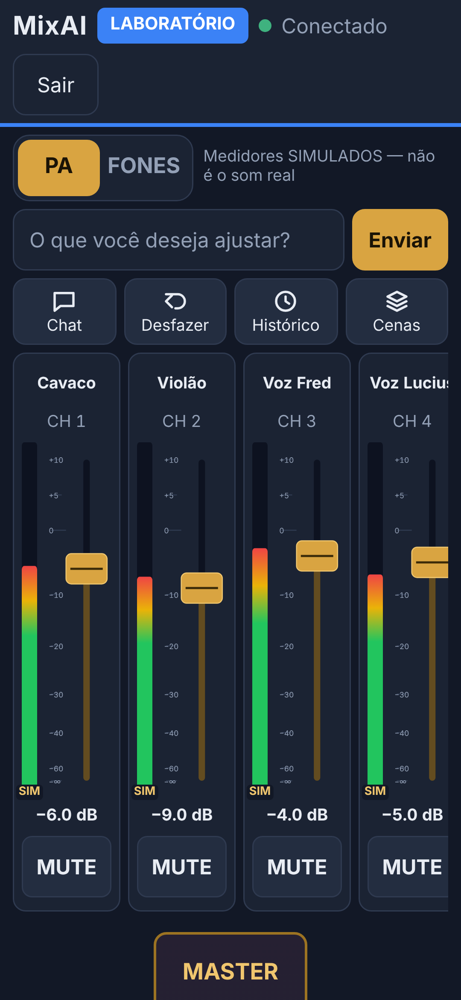
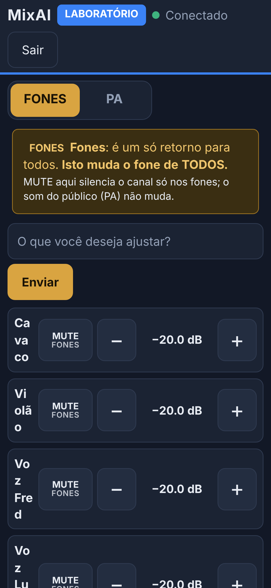
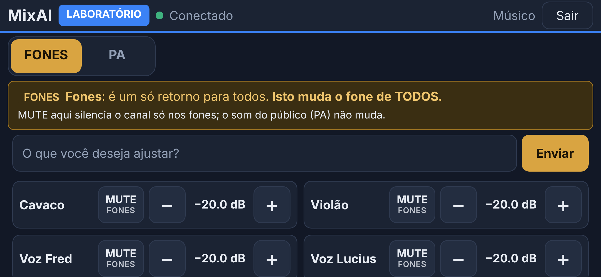
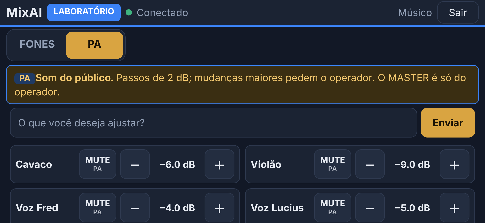

# Celular deitado e MUTE rápido do músico

Branch `fix/mobile-landscape-mute`. Ajustes de UX vindos do teste com um celular Samsung Galaxy no Chrome para Android, **só no LABORATÓRIO**. Não inicia a E6.

## 1. Mesa do operador com o celular deitado

**Reproduzido (Playwright, Galaxy S24 deitado, 780×360):** os faders praticamente sumiam; os nomes apareciam e o MASTER continuava à direita.

**Causa (estrutura do layout):**
- Deitado, o celular tem mais de 720 px de largura e caía no **layout do notebook** (as regras de celular eram só `max-width: 720px`).
- Nesse layout a Mesa fica presa à altura da tela (`.mx-view` com `height: 100%`), e a `.mesa-main` encolhe para caber (`flex: 1; min-height: 0`).
- A barra superior quebrava em 2–3 linhas (130–190 px), e sobravam ~90 px para os canais.
- A `.strips` tem `overflow-x: auto`, o que também corta na vertical: o canal precisa de ~330 px (nome, fader com mínimo de 180 px, valor, MUTE), e o fader era cortado.
- O MASTER não tem esse `overflow`, então transbordava e continuava visível.

**Correção:** um layout para **tela baixa** (`@media (max-height: 560px)`, o celular deitado), declarado depois das regras de 720 px. Não vale para o Yoga, que tem mais de 650 px de altura útil.

| Antes | Agora |
| --- | --- |
| Mesa presa à altura da tela | a Mesa cresce com o conteúdo; a **página rola na vertical** |
| canais com ~90 px de altura | canais e MASTER com altura própria: `max(300px, 100dvh − 12px)` (fader com ~200 px, nunca abaixo do usável) |
| barra em 2–3 linhas | barra de estado e barra de ferramentas compactas, **uma linha cada**; com largura de 780 px ou mais, PA/FONES, assistente, Assistente, Desfazer, Histórico e Cenas cabem inteiros |
| MASTER transbordando | grade: canais à esquerda (rolagem horizontal), MASTER separado à direita; Assistente, Histórico e aprovações embaixo, em largura total |

A legenda "Medidores SIMULADOS" sai da barra nesse modo (cada canal continua com o selo SIM). O aviso dos FONES continua. Nenhum controle foi escondido e nada depende de `z-index`.

**Motivo do envio bloqueado (correção da E4 preservada, revisão do PR #10):**
- Deitado, o motivo do Enviar desabilitado aparece numa **linha própria, logo abaixo da barra, em largura total**: "Sem conexão com o servidor — reconectando. Nada é enviado enquanto isso." ou "Esperando a resposta do pedido anterior…".
- Para isso, o campo, o botão e o motivo viram itens da própria barra (`display: contents`).
- Não depende de `title` nem de `aria-describedby`.
- O texto digitado continua no campo e nada é enviado até a conexão voltar.
- Com o envio liberado, a barra continua numa linha (em 780 px ou mais).

**Rotação:**
- **Sem recarregar:** valores e posição dos faders vêm do estado do servidor e não mudam.
- **Rolagem horizontal mantida:** a Mesa guarda qual canal está à esquerda e volta a ele quando a área muda de tamanho.
- **Nenhum comando durante a rotação.** O fader tratava `pointercancel` (o sistema cancela o toque ao girar) como "soltou" e **enviava o valor**. Agora `pointercancel` só cancela na tela. Se o gesto já tinha enviado valores, o servidor fecha o gesto sozinho, como quando a conexão cai no meio de um arraste.

**Aparelhos estreitos:** em 658 px de largura (Galaxy S9+ deitado), a barra quebra em duas linhas (o "Cenas" vai para a segunda), com todos os botões à vista. A página rola na vertical e o fader continua com ~160 px.

## 2. MUTE rápido do músico

Cada canal tem um botão **MUTE / ABRIR** nos FONES e, quando autorizado, no PA (`web/src/app/views/fones-list.component.ts`).

| Modo | FONES | PA |
| --- | --- | --- |
| `fones_only` (padrão) | MUTE/ABRIR no AUX autorizado | não aparece; o servidor recusa |
| `pa_without_master` | MUTE/ABRIR | MUTE/ABRIR de **um** canal com um toque |

- **Correção do `toggleMute()`:** ele não enviava o AUX (só funcionava no PA). Agora FONES envia `aux: <AUX dos músicos>` e PA vai sem AUX, sempre **um canal**.
- **O botão:**
  - mostra o destino (`MUTE` com "FONES" ou "PA" embaixo);
  - fica **vermelho** quando mutado, e a linha ganha borda vermelha;
  - tem pelo menos 48 px;
  - atualiza o estado pela resposta do servidor;
  - fica desabilitado sem conexão e durante o pedido pendente, quando mostra "…" e toques repetidos não geram outro comando.
- **Aviso nos FONES:** "MUTE aqui silencia o canal só nos fones; o som do público (PA) não muda."
- **Sem mute geral** e sem MASTER para o músico. A autorização do servidor **não mudou**: ele já recusava PA em `fones_only`, mute em grupo no PA e master.

## 3. Músico deitado

- `−`, `+` e MUTE visíveis e com pelo menos 44 px de altura.
- Valor sem invadir o `+`.
- Com 760 px de largura ou mais, os canais ficam em **duas colunas**, aproveitando a largura.
- A página não rola para o lado.

## Testes

| Conjunto | Total | Novos |
| --- | --- | --- |
| Servidor (`npm test`) | 335 | — (a autorização não mudou) |
| Interface (`npm run test:web`) | 49 | 3: AUX no comando dos FONES, PA sem AUX, toque repetido, sem conexão |
| E2E (`npm run test:e2e`) | 46 | 11 em `test/e2e/mobile.test.ts` |

**Os 9 e2e** (Galaxy S24, Chromium com toque):
- **Operador:**
  - retrato;
  - deitado: faders inteiros dentro da fileira, rolagem horizontal, MASTER separado, barra numa linha com todos os botões na tela, rolagem vertical, fader funcionando, PA/FONES, Histórico e Cenas abrindo;
  - **retrato → deitado → retrato sem recarregar**, com valores e canal à vista mantidos e **nenhum comando enviado**;
  - **toque real cancelado** (`touchCancel` via CDP), sem envio.
- **Músico:**
  - `fones_only`: MUTE/ABRIR só no AUX, PA e MASTER recusados por WebSocket forjado;
  - `pa_without_master`: PA e FONES com um toque, sem MASTER, mute em grupo recusado;
  - toques repetidos com o pedido pendente viram **um** comando, e o botão fica desabilitado sem conexão;
  - deitado: duas colunas, sem rolagem lateral.
- **Yoga sem regressão:** página sem rolagem, faders com mais de 300 px, legenda e 11 canais.

O registro de comandos é ligado **antes** do login: o teste confere que ele captura frames, para que "nenhum comando" não passe sem conferir nada.

**Envio bloqueado deitado (2 testes):**
- a conexão cai com texto digitado: o motivo aparece visível, dentro da tela e abaixo do campo; Enter e Enviar não mandam nada, e o texto fica;
- ao reconectar, o motivo some, a barra volta a uma linha e o pedido sai **uma** vez;
- o motivo "Esperando a resposta" também aparece com o celular deitado.

**Mutações conferidas:**
- com o `pointercancel` antigo, o teste do toque cancelado falha (1 comando enviado);
- sem o AUX no `toggleMute()`, 3 testes falham;
- com `.assist-hint { display: none }` no modo deitado, os 2 testes do envio bloqueado falham.

**Teste anterior ajustado:** o `ui.test.ts` contava 22 botões `.step` do músico. Agora são 33 (11 canais × MUTE, −, +), mantendo a verificação de pelo menos 48 px.

As capturas desta página saem de `npm run screenshots`. As do músico na E3/E4 foram regeneradas, porque agora mostram o MUTE.
