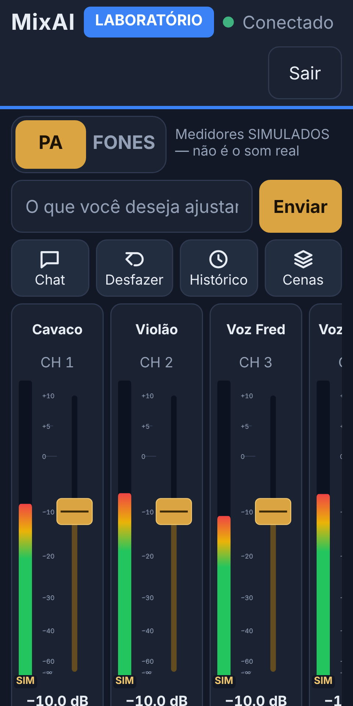
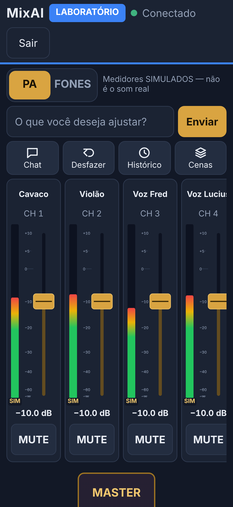
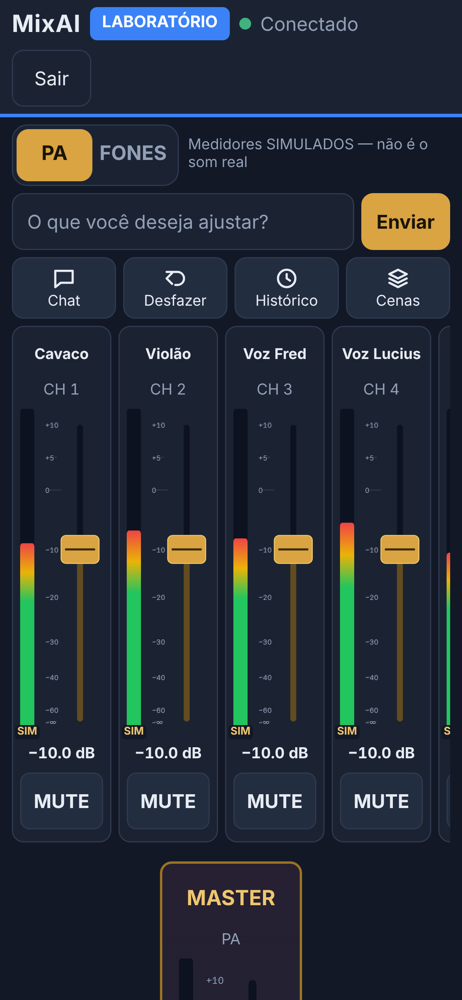
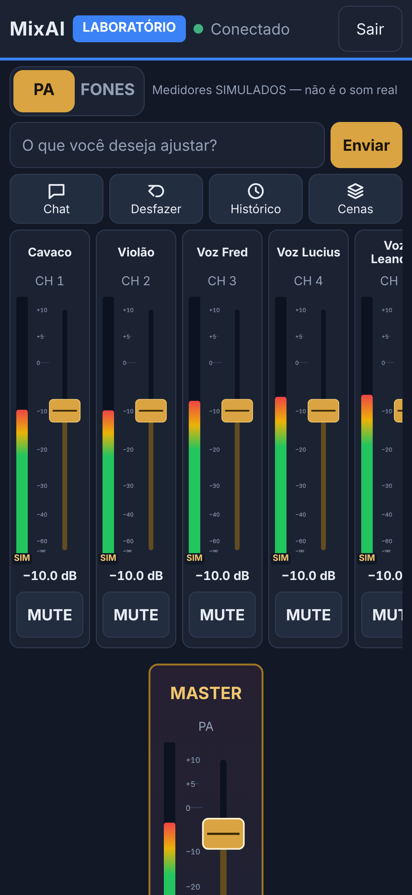

# Barra compacta da Mesa no celular em retrato

Branch `fix/mobile-portrait-toolbar`. Ajuste de UX **só da Mesa do operador em celular em retrato**. O layout do celular deitado (PR #10), o do Lenovo Yoga, as permissões e o backend **não mudaram**. Validação só no LABORATÓRIO, sem mudanças na conexão real.

## Problema

Em retrato, Assistente, Desfazer, Histórico e Cenas ocupavam duas linhas grandes. O campo do assistente e o Enviar ficavam em mais duas, separados. Com 360 px de largura, a barra media **346 px** e o fader começava em 515 px.

## Solução

Barra específica para `max-width: 720px` **e** `min-height: 561px` (celular em retrato; o deitado tem regra própria):

1. **PA / FONES** e, ao lado, o aviso de medidores simulados em versão curta ("Medidores SIMULADOS — não é o som real"). No FONES, aparece o aviso do retorno compartilhado.
2. **Campo do assistente + Enviar** compacto, na mesma linha. O motivo do envio bloqueado continua aparecendo logo abaixo (correção da E4).
3. **Chat · Desfazer · Histórico · Cenas:** quatro botões iguais numa linha, com **ícone SVG simples + rótulo curto**, todos com **pelo menos 48 × 48 px**.
4. Canais e faders.

| Largura | Barra antes | Barra agora | Fader começa em (antes → agora) |
| --- | --- | --- | --- |
| 320 px | 346 px | 176 px | 515 → 345 px |
| 360 px | 346 px | 176 px | 515 → 345 px |
| 390 px | 292 px | 176 px | 461 → 345 px |
| 430 px | 272 px | 176 px | 405 → 309 px |

**Detalhes:**
- **Nomes acessíveis completos:** os botões têm `aria-label` "Assistente", "Desfazer", "Histórico" e "Cenas" (o rótulo visível "Chat" é só no retrato).
- **Fora do retrato,** o grupo de ações é transparente (`display: contents`) e ícones e rótulos curtos ficam escondidos. Yoga e celular deitado ficam como antes (medido: mesma barra de 130 px no Yoga a 125%, mesmas posições).
- **Sem rolagem lateral** da página nem da barra.
- **Tela estreita demais** (menos de 240 px): as ações passam para 2 × 2, sem sobreposição.
- **Nenhuma funcionalidade foi escondida.** As aprovações continuam iguais.

## Testes (`test/e2e/portrait.test.ts`, 9)

- **Em 320, 360, 390 e 430 px:**
  - ordem das linhas (PA/FONES e aviso → campo + Enviar lado a lado → quatro ações na mesma linha → canais);
  - alvos de pelo menos 48 × 48;
  - ícone e rótulo curto visíveis;
  - fader visível na primeira tela, com pelo menos 140 px;
  - barra com no máximo ~190 px;
  - **nenhuma sobreposição** entre os controles nem com os canais;
  - sem rolagem lateral.
- **Os quatro botões funcionam:** Chat abre o assistente, Desfazer desfaz no LAB, e Histórico e Cenas abrem.
- **Envio bloqueado em 320 px:** o motivo aparece entre o campo e as ações, sem sobrepor, e o texto fica.
- **Aprovação de master** pelo cartão, como antes.
- **230 px:** ações em 2 × 2, sem sobreposição.
- **Yoga e deitado sem mudança:** rótulos completos, sem ícones, mesma barra.

**Testes anteriores ajustados:** dois unitários da interface procuravam o botão pelo texto exato ("Assistente", "Cenas"). Agora procuram pelo **nome acessível**, já que no retrato o texto visível é "Chat".

## Fora do escopo (observado)

- **Barra de estado em retrato:** o "Sair" quebra para uma segunda linha, abaixo de MixAI / LABORATÓRIO / Conectado. Não foi alterada aqui.
- **Yoga:** o "Cenas" já ficava numa segunda linha da barra desde a E5 (130 px). Mantido, porque o pedido é não alterar o Yoga.
