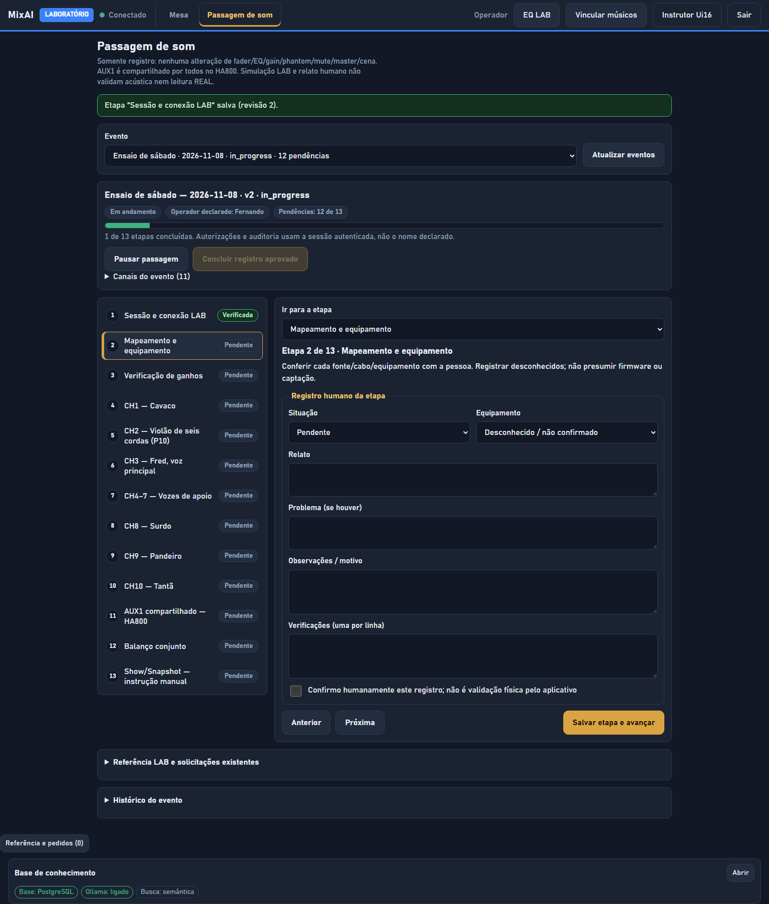
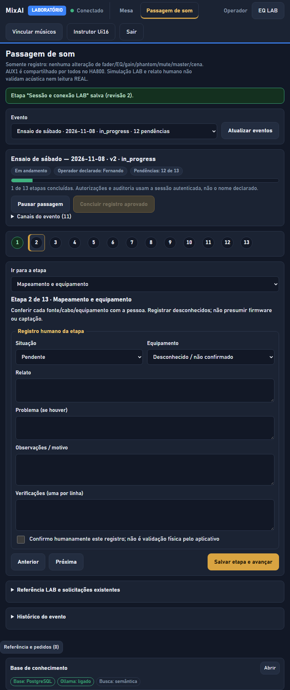
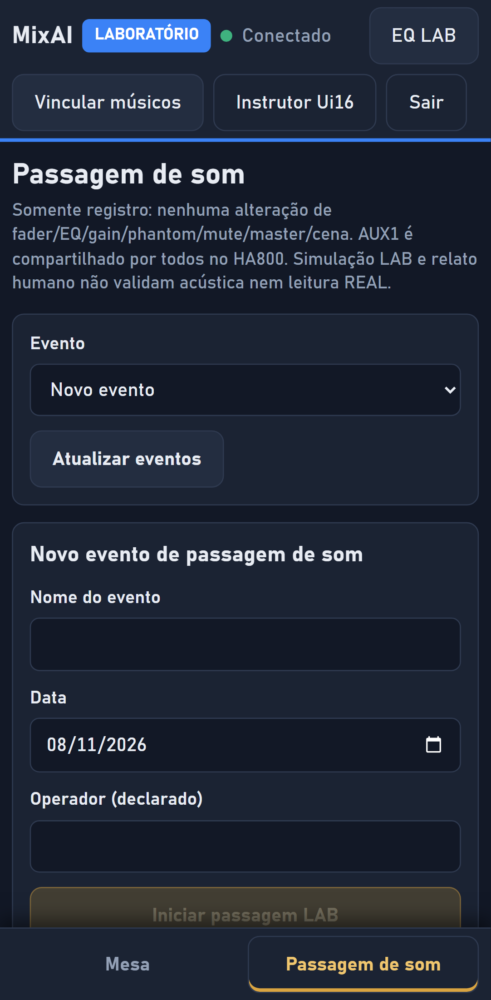
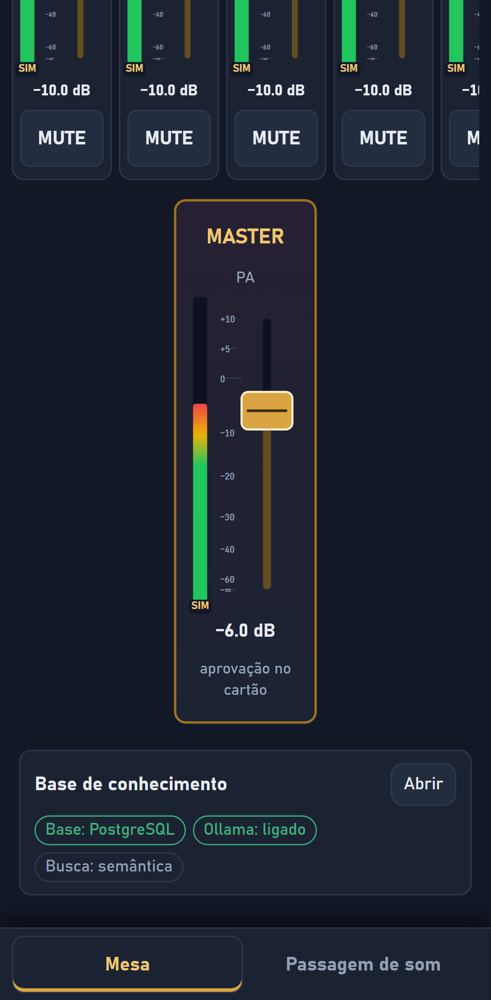
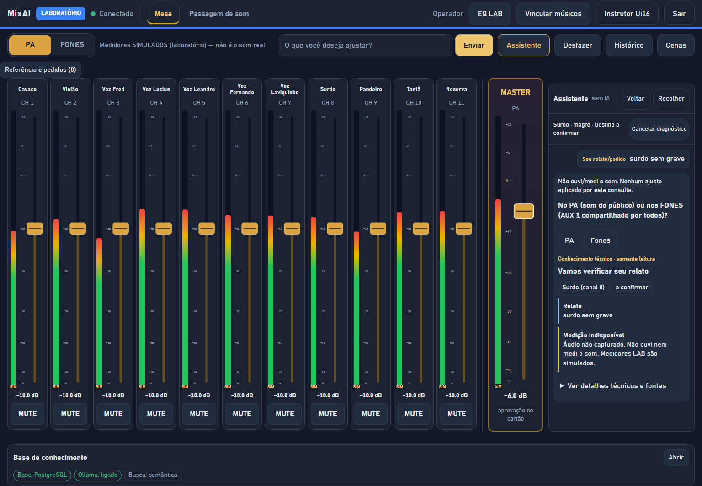

# 24 — Instrutor com biblioteca real, embeddings do corpus técnico, qualidade do resumo local e UX da passagem de som

Branch `fix/instructor-knowledge-soundcheck-ux`, a partir da `main` em `dba12d4` (PRs #68, #69, #70). Somente LAB. **Nenhum comando para a
Ui16, nenhuma alteração de PIN, autenticação ou rede.** Origem: validação integrada no ROG (relatório do PR anterior).

## 1. Instrutor Ui16 usa a biblioteca técnica real

Antes: o Instrutor carregava `instructor-fixtures` (7 tarefas "FIXTURE TEMPORÁRIA") e não consumia os 15 procedimentos reais de `/api/knowledge/procedures`,
que é rota administrativa exclusiva do operador.

- **Rota nova** `GET /api/instructor/procedures` ([`src/server/instructor-routes.ts`](../../src/server/instructor-routes.ts)): operador **e** músico
  autenticados, só em LAB, só GET (qualquer outro método → 404), `cache-control: no-store`, sessão revalidada no envio (revogada → 401), agente MCP → 403,
  sem token → 401. **`/api/knowledge/*` não mudou** (músico continua com 403 ali).
- **Conteúdo** = `publishedInstructorLibrary()` (em `src/assistant/sound-engineer.ts`, o módulo já autorizado a consumir a base determinística; o teste
  de isolamento da base **não** foi afrouxado): cada procedimento é relido pelo esquema estrito e a biblioteca inteira é recusada se algum não declarar
  `execution: not_executable`, `realWrites: false` e `requiresHumanReview: true`. Nada de banco, IA, mesa, controlador ou fila.
- **Adaptador tipado** ([`instructor-library.ts`](../../web/src/app/instructor/instructor-library.ts)): `parseServerLibrary` valida o contrato do servidor e
  `libraryToCatalog` o converte para o contrato de apresentação (título = `purpose` publicado; `control` vira rótulo, nunca seletor ou posição). Qualquer
  procedimento executável, link não HTTPS, id/versão inválidos ou duplicados invalida tudo (`incompatible`); campos desconhecidos são descartados.
- **Estados tratados:** sessão expirada (401 → mesmo caminho das outras telas: volta ao login), acesso negado, indisponibilidade (rede/5xx/404 fora do LAB),
  versão incompatível, biblioteca vazia. Mensagens próprias, nova tentativa possível, sem vazar o erro do servidor.
- A fixture ficou **só para testes/desenvolvimento** (injetada via `INSTRUCTOR_CATALOG`). O conteúdo real aparece como "TEORIA — não validada em ensaio".
- Testes: `test/instructor-routes.test.ts` (6), `instructor-library.spec.ts` (26), E2E `ui16-instructor.test.ts` (15 procedimentos; Yoga, celular, paisagem; músico).

## 2. `import-technical` gera embeddings

Antes: gravava 54 trechos com `embeddings: not_generated`; o corpus em português (o mais próximo das perguntas do operador) ficava invisível à busca vetorial.

- `importTechnicalCorpus(store, embedder?)` usa o **provedor de embeddings configurado para a coleção** (no ROG: BGE-M3, 1024 dimensões, local).
- **Idempotente e retomável:** documento igual e completo = `unchanged`; igual com vetores faltando = `repaired` (só os pendentes); novo/alterado = grava e vetoriza.
- **Provedor fora do ar ou queda no meio:** documentos preservados, `embeddings: pending|partial`, reparados na próxima execução. Nada é apagado.
- **Privacidade:** nunca toca outras fontes/coleções; provedor externo só recebe o corpus técnico público e versionado (fonte com https público), nunca documento do operador.
- Relatório: `imported, unchanged, repaired, chunks, embedded, pending, embeddings, provider`.
- Testes: `test/technical-embeddings.test.ts` (8).

Medido no ROG (PostgreSQL + BGE-M3 `bgem3`, 24 perguntas em português, k = 4, `npm run knowledge -- eval --live`):

| Estado | Acerto@k | Hit@1 | Hit@3 | MRR |
|---|---|---|---|---|
| BGE-M3 sem o corpus técnico vetorizado (`auto`) | 79% | 42% | 71% | 0,57 |
| **BGE-M3 + corpus técnico vetorizado (`auto`)** | **88%** | **58%** | **88%** | **0,71** |
| mesmo, busca `hybrid` | 79% | 63% | 75% | 0,68 |

Reparo de 15 documentos / 54 trechos em 4,8 s; segunda execução 0,7 s (idempotente); coleção final 22 documentos, 421 trechos, 421 embeddings; `public` e `kb_gem768` intactas.
Observação: "surdo" cai de 4/4 para 1/4 **só no critério da avaliação**, que aceita termos em inglês ("bass drum"); a busca agora devolve primeiro o artigo em
português "Surdo sem grave, seco ou sem definição". O conjunto de perguntas foi mantido idêntico para a comparação.

## 3. Qualidade do resumo local (Qwen3 8B)

Respostas reais observadas quando os trechos eram fracos: hipóteses opostas ("muito longe… muito próximo"), fora do assunto (microfonia → "resposta de frequência
desequilibrada") e especulação sobre o operador. Correção em [`service.ts`](../../src/knowledge/local/service.ts), sem mudar a arquitetura dos provedores:

- Prompt: no máximo 3 frases, cada uma sustentada por um trecho, sem hipóteses opostas, sem especular, "não há base suficiente nos trechos" quando não tratam do problema.
- `judgeNarrative(raw, passages, {symptom})`: regras de **qualidade** `hipoteses_opostas` e `fora_do_assunto` → o resumo vira "sem base suficiente" (`empty`) com
  mensagem de incerteza ao operador; **não** aciona outro provedor e **não** altera o diagnóstico determinístico. Regras de segurança têm prioridade.
- Testes: `test/narrative-quality.test.ts` (12), com as respostas reais; respostas legítimas continuam passando.
- Resultado no ROG: 5 perguntas em 1,0–2,3 s, todas ancoradas no corpus técnico.

## 4. UX da passagem de som

- **Tela independente** na navegação principal (abas **Mesa** | **Passagem de som**, `aria-current`); a Mesa deixa de hospedar o painel. Aprovações pendentes aparecem
  num aviso com atalho "Ir para a Mesa". Eventos, históricos, pausa, retomada e recuperação **não mudaram** (E2E existente do ciclo completo passa).
- **Checklist progressivo:** uma etapa por vez (1 formulário em vez de um seletor solto), lista com a situação de cada uma, barra de progresso falada
  ("5 de 13 etapas concluídas · 1 com problema"), Anterior/Próxima, foco no título após salvar. Celular/tablet: faixa compacta de números coloridos.
  Campos de relato/problema/observações viraram áreas de texto largas; "Problema" ganha destaque quando a situação é problema.
- **Navegação no celular em retrato:** as abas viram uma barra fixa **embaixo** (ao alcance do polegar). No topo elas custavam uma linha inteira e empurravam os faders para fora da primeira tela (garantia de `portrait.test.ts`, que falhou no CI do Ubuntu a 320×640: fader a 547 px, limite 520; agora ~437 px). Tablet, desktop e celular deitado mantêm as abas no topo.
- **Sobreposição corrigida (causa raiz):** a Mesa tinha altura fixa de `100dvh` com a área dos faders em `flex: 1 1 0`; qualquer coisa que crescesse acima a espremia e o
  conteúdo transbordava sobre o que vinha depois (MASTER sobre a Base de conhecimento; texto do assistente cortado). Agora a página cresce e a área dos faders tem
  altura mínima; no celular em retrato o MASTER aparece inteiro, em vez de uma fatia dentro de rolagem interna.
- Testes: `soundcheck-ux.test.ts` (12: Yoga, tablet, celular, celular deitado, com a Base de conhecimento ligada), `soundcheck-progress.spec.ts` (5), `soundcheck.test.ts` atualizado.

| Desktop | Tablet | Celular |
|---|---|---|
|  |  |  |

Mesa no celular (MASTER sem sobreposição) e assistente no desktop:  

## Limites e pendências

- Procedimentos do Instrutor são teoria editorial (não validada em ensaio nem no firmware); conexão/hotspot, nome de canal e Shows/Snapshots **não** estão na biblioteca real (as 7 tarefas da fixture eram 3 a mais).
- A regra `fora_do_assunto` usa vocabulário por sintoma (heurística): vale ampliar com os relatos reais de ensaio.
- O bundle inicial passou de 414,8 para 416,3 kB (aviso de orçamento de 400 kB já existia; orçamento não foi alterado).
- Não testado: toque real em Android/Yoga, rede privada, firmware, escuta acústica.
